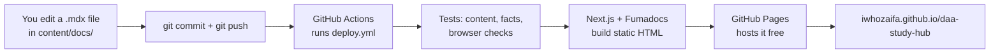

This page explains every tool and file behind the site, so you understand it instead of treating it as magic.

<Callout type="info" title="Principle: off-the-shelf first">

The site is a ready-made documentation framework (Fumadocs) plus configuration. Hand-written code is
limited to the landing page, a small countdown, the Mermaid recipe from the Fumadocs docs, and the tests.

</Callout>

## The big picture



If any test fails, the site is **not** updated, so a broken page never goes live.

## Your progress lives in your browser

There are no accounts and no server. Each visitor's ticks, mock scores and mistakes are saved in **their own browser**
(`localStorage`), so everyone gets a private tracker for free and nobody else can see it. The trade-offs:

- It's **per device and per browser**. Use **Export / Import** on [My progress](progress.mdx) to move or back it up.
- Clearing browsing data erases it, so export now and then.
- It's honour-based: "Mastered" only unlocks after ticking *solved with no hints* plus the five explain-back steps.

## Tools (one sentence each, and why each beats building it yourself)

| Tool | What it does | Why not build it yourself |
|---|---|---|
| **Markdown / MDX** | Plain-text notes; MDX is markdown that can also hold a few ready-made components (tabs, callouts). | Readable anywhere and diff-able in Git, so the notes aren't locked into any app. |
| **Git + GitHub** | Saves every version and hosts the repository. | You can undo anything, and classmates can suggest fixes. |
| **React** | The UI library the whole web runs on; pages are built from components. | Huge ecosystem: every widget below already exists. |
| **Next.js** | Turns the React app into plain static HTML files (`output: 'export'`). | Routing, bundling and optimisation for free. |
| **Fumadocs** | A complete docs site for Next.js: sidebar, search, dark mode, table of contents, tabs, accordions, callouts. | Months of UI work, already done and maintained. |
| **shadcn/ui** | Beautiful, accessible components (cards, buttons, badges) generated into `components/ui/` by a CLI. | Polished design without designing every button. |
| **Tailwind CSS** | Styling with small class names like `text-hazard` or `grid-cols-3`. | No giant hand-written stylesheet to maintain. |
| **KaTeX** | Draws formulas like $T(n) = 2T(n/2) + n$ at build time. | Writing a maths renderer is a project of its own. |
| **Mermaid** | Draws diagrams (like the one above) from text. | Diagrams stay inside the note as text. |
| **Vitest** | Runs fast checks on the content and recomputes the numbers in the notes. | A mistake in a worked example gets caught before you study it. |
| **Playwright + axe** | Opens the real site in a browser, clicks tabs and answers, and checks accessibility and contrast. | Tests the site the way you use it, automatically. |
| **GitHub Actions + Pages** | A free robot that tests, builds and publishes on every push. | No server, zero cost. |

## Every file, and what it does

| File / folder | Purpose |
|---|---|
| `content/docs/` | **All the notes.** Every `.mdx` file is a page. |
| `content/docs/meta.json` (+ `practice/meta.json`) | **The sidebar:** page order and the section headings (Plan, Topics, Toolbox…). New page? Add its name here. |
| `content/docs/topics/NN-*.mdx` | One page per topic, with the four study-mode tabs. |
| `app/(home)/page.tsx` | The landing page (hero, mode cards, topic grid, toolbox). |
| `app/global.css` | **The palette** (hazard orange, blood red, ring gold on warm ink / manga paper) and the halftone texture. |
| `app/layout.tsx` | Fonts (Bebas Neue for headings, Inter for text, JetBrains Mono for code). |
| `app/docs/` | The notes layout (sidebar + page) from the Fumadocs template. |
| `components/ui/` | shadcn/ui components, generated by `npx shadcn add`. |
| `components/mdx.tsx` | Which components MDX pages can use (`Tabs`, `Accordion`, `Callout`, `Mermaid`). |
| `components/mermaid.tsx` | The Mermaid recipe from the Fumadocs docs, coloured to match. |
| `components/days-left.tsx` | The midterm countdown on the home page. |
| `lib/progress.ts` | The tracker's rules (e.g. "Mastered needs all six ticks") and the checks run on imported files. No React, so it's easy to test. |
| `components/progress/` | The tracker UI: the card on each topic page, the My progress dashboard, the score form and the home-page badges. |
| `lib/source.ts` | Tells Fumadocs where the notes are and turns on maths + Mermaid. |
| `lib/shared.ts`, `lib/layout.shared.tsx` | Site name, GitHub link and top navigation. |
| `next.config.mjs` | Static export to `out/` and the `/daa-study-hub` URL prefix. |
| `tests/` | `content.test.ts`, `facts.test.ts`, `progress.test.ts` (Vitest) and `e2e/site.spec.ts`, `e2e/progress.spec.ts` (Playwright). |
| `.github/workflows/deploy.yml` | Test → build → publish. It also refuses to continue if a PDF or slide file is tracked. |
| `flashcards/daa-flashcards.csv` | Anki flashcards. |
| `package.json` / `package-lock.json` | The exact versions of every tool, so your laptop and GitHub build the same thing. |

## Everyday commands

```bash
npm install              # once, after cloning
npm run dev              # live preview at http://localhost:3000/daa-study-hub
npm test                 # content + facts checks (a few seconds)
npm run test:e2e         # build the site and click through it in a real browser
git add -A && git commit -m "Notes: topic 3 session" && git push   # publish (tests run first)
```

## MDX tricks used on these pages

```mdx
<Tabs groupId="study-mode" persist items={["Visual", "Worked example"]}>
<Tab value="Visual">

Content of the first tab

</Tab>
</Tabs>

<Accordions>
<Accordion title="✅ Answer">

Hidden until clicked

</Accordion>
</Accordions>

<Callout type="idea" title="Mastery check">

An always-visible box (types: info, idea, success, warn, error)

</Callout>

Inline maths $n\log n$ and display maths:

$$
\sum_{i=1}^n i = \frac{n(n+1)}{2}
$$
```

Two MDX rules to remember: leave a **blank line** inside each component around your text, and write `\{`, `\}` and `&lt;`
in ordinary text, because `{` and `<` mean "code" to MDX. Inside `$maths$` and code you can write them normally.

## Flashcards (Anki)

`flashcards/daa-flashcards.csv` holds 70 cards (`Front,Back,Tags`), tagged by topic (for example `t4 insertion`). Open Anki →
**File → Import** → pick the CSV. The `#…` lines at the top already set the separator and columns. Anki then schedules
spaced repetition for you, which is why we use it instead of building a quiz app.
