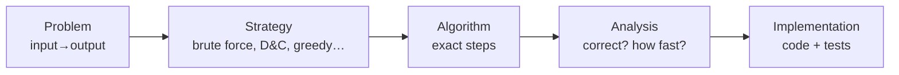

<Callout type="info" title="In one sentence">

An algorithm is a precise, finite recipe that turns an input into an output. We judge it by
**counting how many basic steps it takes as the input size $n$ grows**, written $T(n)$.

</Callout>

## Everyday analogy

A **recipe**. A good recipe:

- lists its **ingredients** (input) and tells you what dish you'll get (**output**);
- has steps that are **clear** ("add 5 g salt", not "add some salt"): *definiteness*;
- **ends** at some point, not "stir forever": *finiteness*;
- only asks for things a cook can actually do: *effectiveness*.

Two cooks with different stoves (Java vs. C, fast vs. slow laptop) follow the *same* recipe. That's why
we analyse the recipe itself, not one cook's stopwatch time.

## Key ideas

| Idea | Meaning |
|---|---|
| 5 properties | input, output, definiteness, finiteness, effectiveness |
| Input size $n$ | how "big" the input is (array length, number of digits, …) |
| $T(n)$ | number of basic steps on an input of size $n$ |
| Cost × frequency | total time = Σ (cost of a line × how many times it runs) |
| Best / worst / average case | fewest / most / typical steps over all inputs of size $n$ |
| Why not just time it? | stopwatch results depend on machine, language and the inputs you happened to try |

**Pseudocode conventions used in this course:** `←` means assignment, `=` means equality test,
arrays start at index 1 (`A[1..n]`), and loops are written `for i ← 1 to n do`.

---

<Tabs groupId="study-mode" persist items={["Visual", "Worked example", "Guided questions", "Explanation & drill"]}>
<Tab value="Visual">

**Counting steps for `CountNegatives`** (our own example)

```text
CountNegatives(A, n)
1  count ← 0
2  for i ← 1 to n do
3      if A[i] < 0 then
4          count ← count + 1
5  return count
```

| Line | Cost | Times it runs | Why |
|---|---|---|---|
| 1 | $c_1$ | 1 | once at the start |
| 2 | $c_2$ | $n + 1$ | $n$ successful checks + 1 failing check that ends the loop |
| 3 | $c_3$ | $n$ | once per element |
| 4 | $c_4$ | between $0$ and $n$ | depends on how many negatives |
| 5 | $c_5$ | 1 | |

$$
T(n) = c_1 + c_2(n+1) + c_3 n + c_4\cdot(\#\text{negatives}) + c_5
$$

- **Best case** (no negatives): $T(n) = (c_2 + c_3)n + (c_1 + c_2 + c_5)$, which is linear.
- **Worst case** (all negative): $T(n) = (c_2 + c_3 + c_4)n + (\dots)$, still linear.

**The pipeline from problem to program**



</Tab>
<Tab value="Worked example">

**Problem.** How many times does `x ← x + 1` run?

```text
for i ← 1 to n do
    for j ← 1 to i do
        x ← x + 1
```

**Step 1: write out a small case** ($n = 4$):

| $i$ | inner loop runs $j = 1..i$ | adds |
|---|---|---|
| 1 | 1 | 1 |
| 2 | 1, 2 | 2 |
| 3 | 1, 2, 3 | 3 |
| 4 | 1, 2, 3, 4 | 4 |
| | **total** | **10** |

**Step 2: spot the pattern.** The total is $1 + 2 + \dots + n$.

**Step 3: use the sum formula** from [Topic 0](00-math-toolkit.mdx): $\frac{n(n+1)}{2}$. Check: $\frac{4\cdot5}{2} = 10$ ✓

**Step 4: state the growth.** $\frac{n^2}{2} + \frac n2$ grows like $n^2$, so the loop is **quadratic**.

**Doubling check** (a quick sanity test from experiments): if a program takes 1 s for $n = 1000$, 4 s for $n = 2000$ and 16 s for $n = 4000$, the time ×4 each time $n$ doubles. $2^2 = 4$, so the algorithm behaves like $n^2$.

</Tab>
<Tab value="Guided questions">

**Q1.** A "recipe" says: *"repeat: add 1 to x"*, with no stopping rule. Which property fails?

<Accordions>
<Accordion title="✅ Answer">

**Finiteness**: it never terminates.

</Accordion>
</Accordions>

**Q2.** Why does the header `for i ← 1 to n` run $n + 1$ times, not $n$?

<Accordions>
<Accordion title="💡 Hint">

Think about the last time the condition is checked.

</Accordion>
<Accordion title="✅ Answer">

It checks $i \le n$ for $i = 1, \dots, n$ (true, $n$ times) and then once more with $i = n + 1$ (false), which ends the loop.

</Accordion>
</Accordions>

**Q3.** Why don't we just time programs with a stopwatch?

<Accordions>
<Accordion title="✅ Answer">

Timings depend on hardware, language, compiler and which test inputs you chose. Counting steps as a function of $n$ is machine-independent and covers *all* inputs.

</Accordion>
</Accordions>

**Q4.** For `CountNegatives`, which input of size 5 gives the worst case?

<Accordions>
<Accordion title="✅ Answer">

Any array with all 5 elements negative, e.g. `[-1, -2, -3, -4, -5]`. Line 4 then runs every time.

</Accordion>
</Accordions>

</Tab>
<Tab value="Explanation & drill">

**Explanation.** We model running time as **cost × frequency** summed over all lines. The exact costs $c_i$ depend on the machine, so we keep them as symbols and focus on how the **frequencies** grow with $n$. Usually only the fastest-growing term matters (made precise in [Topic 6](06-asymptotic-notation.mdx)). Because inputs of the same size can behave differently, we talk about the **best**, **worst** and **average** case. Exams almost always ask for the **worst case**, because it's a guarantee.

**Drill**

**1.** How many times does the body run? `for i ← 1 to n do for j ← 1 to n do body`

<Accordions>
<Accordion title="✅ Answer">

$n \cdot n = n^2$

</Accordion>
</Accordions>

**2.** And this one? `for i ← 1 to n do for j ← i+1 to n do body`

<Accordions>
<Accordion title="✅ Answer">

$(n-1) + (n-2) + \dots + 0 = \frac{n(n-1)}{2}$. This counts every *pair* $(i, j)$ with $i < j$.

</Accordion>
</Accordions>

**3.** Name the five properties of an algorithm.

<Accordions>
<Accordion title="✅ Answer">

Input, output, definiteness, finiteness, effectiveness.

</Accordion>
</Accordions>

**4.** Times go 2 s → 16 s → 128 s as $n$ doubles. What growth does that suggest?

<Accordions>
<Accordion title="✅ Answer">

×8 per doubling, and $2^3 = 8$, so $n^3$ (cubic).

</Accordion>
</Accordions>

</Tab>
</Tabs>

---

## Common mistakes

- Counting a loop header as $n$ instead of $n + 1$.
- Saying "best case = small input". Best/worst case are about inputs of the **same size $n$**.
- Treating a library call like string concatenation or `copy()` as one step. It can cost $\Theta(n)$ itself.

## Mastery check

<Callout type="idea" title="Solve without hints, then explain">

For `FindFirstZero(A, n)`, which scans left to right and stops at the first 0:

(a) Write its pseudocode. (b) How many comparisons does it make in the best and worst case? (c) Give an input that causes each.

</Callout>

<Accordions>
<Accordion title="✅ Answers">

(a) `for i ← 1 to n do if A[i] = 0 then return i` and, after the loop, `return NIL`.

(b) Best: 1 comparison (zero at position 1). Worst: $n$ comparisons (zero at the end or no zero at all).

(c) Best `[0, 5, 7]`; worst `[5, 7, 0]` or `[5, 7, 9]`.

</Accordion>
</Accordions>

<MasteryTracker topic="01-algorithms-and-counting" />

## References

- 01-02 *Introduction*: Slides 9–11 (the 5 criteria, language independence), 27–29 (problem-solving pipeline), 30 (design techniques).
- 03 *Algorithm Analysis*: Slides 9–14 (experimental vs. theoretical analysis), 15–18 (cost × frequency).
- 04 *Correctness & Space*: Slides 3–5 (pseudocode notation).
- CLRS 4e Ch 1 (role of algorithms), §2.2 (analysing algorithms).
