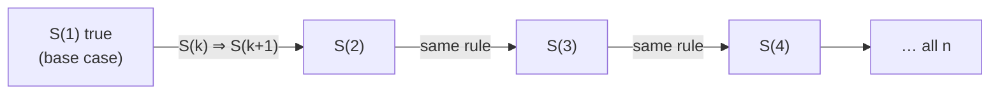
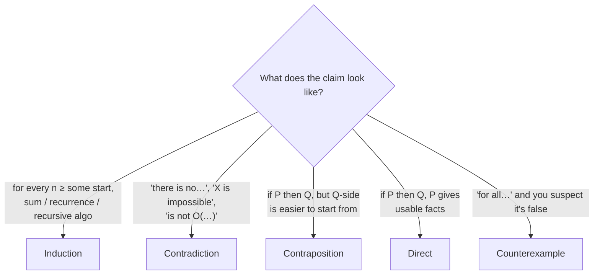

<Callout type="info" title="In one sentence">

A proof is an argument that leaves **no case uncovered**. Four templates cover almost every proof
in this course: **direct**, **contradiction**, **contraposition** and **induction**.

</Callout>

## Everyday analogy

- **Direct proof = following road signs.** Start from what you know and take one justified step at a time until you reach the claim.
- **Contradiction = a detective's alibi check.** "Suppose the butler did it… then he was in two places at 9 pm. Impossible. So the butler didn't do it."
- **Contraposition = proving the reverse, negated.** "If it rained, the ground is wet" is the same claim as "if the ground is dry, it didn't rain."
- **Induction = dominoes.** Show the first domino falls (base case), and that any falling domino knocks over the next (inductive step). Then they **all** fall.

## The four templates

| Technique | To prove | You write |
|---|---|---|
| Direct | $P \Rightarrow Q$ | Assume $P$. … therefore $Q$. |
| Contradiction | $S$ | Assume **not** $S$. … reach something impossible. So $S$. |
| Contraposition | $P \Rightarrow Q$ | Assume **not** $Q$. … therefore **not** $P$. |
| Induction | $S(n)$ for all $n \ge n_0$ | Base: $S(n_0)$. Step: assume $S(k)$, prove $S(k+1)$. |
| Counterexample | "$S$ is false" | Show **one** case where $S$ fails. |

<Callout type="success" title="Strong induction">

In the step you may assume $S(n_0), S(n_0+1), \dots, S(k)$ (**all** smaller cases), not just $S(k)$.
This is useful for recursive algorithms that split into pieces of any smaller size.

</Callout>

---

<Tabs groupId="study-mode" persist items={["Visual", "Worked example", "Guided questions", "Explanation & drill"]}>
<Tab value="Visual">

**Induction as dominoes**

**Which technique? A decision picture**

**Contrapositive truth check**

| Statement | Form | Same truth as the original? |
|---|---|---|
| If $n$ is divisible by 4 then $n$ is even | $P \Rightarrow Q$ | original (true) |
| If $n$ is odd then $n$ is not divisible by 4 | $\neg Q \Rightarrow \neg P$ | ✅ contrapositive: equivalent, also true |
| If $n$ is even then $n$ is divisible by 4 | $Q \Rightarrow P$ | ⚠️ converse: a *different* claim, and false ($n = 6$) |

</Tab>
<Tab value="Worked example">

**Claim.** For all $n \ge 1$: $1 + 2 + 4 + \dots + 2^{n-1} = 2^n - 1$.

**Base case** ($n = 1$). Left side: just the first term, $2^0 = 1$. Right side: $2^1 - 1 = 1$. Equal ✓

**Inductive hypothesis.** Assume, for some $k \ge 1$, $1 + 2 + \dots + 2^{k-1} = 2^k - 1$.

**Inductive step.** Show it holds for $k + 1$, i.e. that the sum up to $2^{k}$ equals $2^{k+1} - 1$:

$$
\underbrace{1 + 2 + \dots + 2^{k-1}}_{= \,2^k - 1 \text{ by hypothesis}} + 2^{k} = 2^k - 1 + 2^k = 2\cdot 2^k - 1 = 2^{k+1} - 1 \checkmark
$$

**Conclusion.** By induction, the claim holds for all $n \ge 1$. ∎

**The pattern to copy:** write the $(k+1)$ case as "*the $k$ case* + *one new piece*", replace the $k$ case with the hypothesis, then do algebra.

---

**Claim (contradiction).** There is no largest even integer.

1. **Assume the opposite:** some even integer $M$ is the largest.
2. $M + 2$ is also even, and $M + 2 > M$.
3. That contradicts "$M$ is the largest".
4. So the assumption is false: there is no largest even integer. ∎

**Claim (contraposition).** If $3n + 2$ is odd, then $n$ is odd.

- Contrapositive: *if $n$ is even, then $3n + 2$ is even.*
- Let $n = 2k$. Then $3n + 2 = 6k + 2 = 2(3k + 1)$, which is even ∎

</Tab>
<Tab value="Guided questions">

**Q1.** In induction, what are you allowed to assume, and what must you prove?

<Accordions>
<Accordion title="✅ Answer">

You **assume** the statement for $k$ (the hypothesis) and must **prove** it for $k + 1$. You never assume the thing you're proving.

</Accordion>
</Accordions>

**Q2.** Someone "proves" a formula by checking $n = 1, 2, 3, \dots, 100$. Is that a proof?

<Accordions>
<Accordion title="💡 Hint">

Try the formula "$n^2 + n + 41$ is always prime" at $n = 40$.

</Accordion>
<Accordion title="✅ Answer">

No. Examples never prove a "for all" claim. $40^2 + 40 + 41 = 1681 = 41^2$ is not prime, even though the formula works for $n = 0..39$. **One** counterexample disproves; **no** number of examples proves.

</Accordion>
</Accordions>

**Q3.** You want to show $n^4 \notin O(n^3)$ (Topic 6). Which technique fits?

<Accordions>
<Accordion title="✅ Answer">

Contradiction: assume constants $c, n_0$ exist with $n^4 \le cn^3$, and derive $n \le c$ for all large $n$, which is impossible.

</Accordion>
</Accordions>

**Q4.** What is the contrapositive of "if an array is sorted, binary search finds the key if it's present"?

<Accordions>
<Accordion title="✅ Answer">

"If binary search fails to find a key that is present, then the array is not sorted."

</Accordion>
</Accordions>

</Tab>
<Tab value="Explanation & drill">

**Explanation.** Every proof has the same shape: *state what you assume → justified steps → conclusion*. Choose a technique by asking what is easiest to **start from**. With $P$ in hand, go direct. If "not $Q$" gives you something concrete (like "$n$ is even, so $n = 2k$"), use contraposition. If the claim says something *can't* happen, assume it does and break it (contradiction). If the claim is about every $n$, especially sums, recurrences or recursive algorithms, use induction. Recursion and induction are the same idea seen from two sides: a recursive call trusts the smaller case, and the inductive hypothesis *is* that trust.

**Drill**

**1.** Prove directly: the sum of two odd integers is even.

<Accordions>
<Accordion title="✅ Answer">

Let $a = 2p + 1$ and $b = 2q + 1$. Then $a + b = 2p + 2q + 2 = 2(p + q + 1)$, which is even ∎

</Accordion>
</Accordions>

**2.** Prove by induction: $\sum_{i=1}^{n} (2i) = n(n+1)$.

<Accordions>
<Accordion title="✅ Answer">

Base $n = 1$: $2 = 1\cdot2$ ✓. Step: $\sum_{i=1}^{k+1} 2i = k(k+1) + 2(k+1) = (k+1)(k+2)$ ✓ ∎

</Accordion>
</Accordions>

**3.** Prove by contraposition: if $n^3$ is even, then $n$ is even.

<Accordions>
<Accordion title="✅ Answer">

Contrapositive: if $n$ is odd then $n^3$ is odd. With $n = 2k + 1$: $n^3 = 8k^3 + 12k^2 + 6k + 1 = 2(4k^3 + 6k^2 + 3k) + 1$, which is odd ∎

</Accordion>
</Accordions>

**4.** Disprove: "for all $n \ge 1$, $2^n > n^2$".

<Accordions>
<Accordion title="✅ Answer">

$n = 2$: $4 > 4$ is false. ($n = 3$ and $n = 4$ also fail; it only holds from $n = 5$ on.)

</Accordion>
</Accordions>

</Tab>
</Tabs>

---

## Common mistakes

- **Circular induction:** assuming $S(k+1)$ and "showing" it's true.
- **Forgetting the base case.** The steps alone don't start the dominoes falling.
- **Converse ≠ contrapositive.** $Q \Rightarrow P$ is a different claim from $P \Rightarrow Q$.
- In contradiction, not saying **what** the contradiction is. Name the two facts that clash.

## Mastery check

<Callout type="idea" title="Solve without hints, then explain your choice of technique">

Prove for all $n \ge 1$: $3 + 7 + 11 + \dots + (4n - 1) = n(2n + 1)$.

</Callout>

<Accordions>
<Accordion title="✅ Answer">

**Base** $n = 1$: $3 = 1\cdot3$ ✓. **Hypothesis:** the sum up to $4k - 1$ equals $k(2k + 1)$.
**Step:** add the next term $4(k+1) - 1 = 4k + 3$:
$k(2k + 1) + 4k + 3 = 2k^2 + 5k + 3 = (k + 1)(2k + 3) = (k+1)(2(k+1) + 1)$ ✓ ∎

</Accordion>
</Accordions>

## References

- *Supplementary Notes: Proof techniques* (6 pp.): direct proof (p. 1), contradiction and contraposition (p. 2), induction and strong induction (p. 3), worked induction examples incl. a recurrence (pp. 4–6).
- 04 *Correctness & Space*: Slide 17 (induction for recursive algorithms).
- CLRS 4e Appendix A (induction used on summations) and §4.3 (induction used to verify recurrences).
