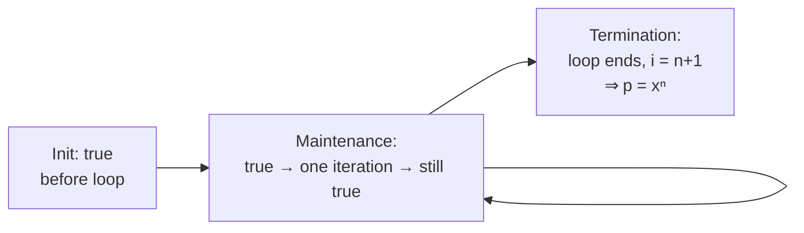

<Callout type="info" title="In one sentence">

To prove an algorithm is correct, show that it **gives the right answer whenever it stops**
(partial correctness) **and** that it **always stops** (termination). For loops, the tool is a
**loop invariant**; for recursion, it's **induction**.

</Callout>

## Everyday analogy

**A running receipt at a shop.** While items are scanned, the screen always shows *"the total of
everything scanned so far"*. That sentence is true:

- **before** the first item (total = 0 for zero items): *initialization*,
- **after every scan**, if it was true before: *maintenance*,
- and **when the last item is scanned**, it tells you exactly what you owe: *termination*.

That sentence is a loop invariant.

## Key rules

$$
\text{Correctness} = \text{Partial correctness} + \text{Termination}
$$

| Part of a loop-invariant proof | What you show |
|---|---|
| **Initialization** | The invariant is true before the first iteration |
| **Maintenance** | If it's true before an iteration, it's still true before the next one |
| **Termination** | When the loop stops, invariant + exit condition ⇒ the output is correct |

| Other tools | Use for |
|---|---|
| **Induction** | recursive algorithms (base case = smallest input; step = trust the recursive call) |
| **Pre/postconditions** | the "contract": *if* the input satisfies the precondition, *then* the output satisfies the postcondition |

<Callout type="success" title="Finding an invariant">

Ask: *"After $i - 1$ rounds, what is true about the part of the input already processed?"*
Write the invariant in terms of the loop variable (`i`) and the processed part (`A[1..i-1]`).

</Callout>

---

<Tabs groupId="study-mode" persist items={["Visual", "Worked example", "Guided questions", "Explanation & drill"]}>
<Tab value="Visual">

**Algorithm** (our own example):

```text
Power(x, n)            // precondition: n ≥ 0
1  p ← 1
2  for i ← 1 to n do
3      p ← p · x
4  return p            // postcondition: p = xⁿ
```

**Invariant:** *at the start of the iteration with loop variable $i$, $p = x^{i-1}$.*

**Trace with $x = 3$, $n = 4$:**

| Moment | $i$ | $p$ | $x^{i-1}$ | Invariant holds? |
|---|---|---|---|---|
| before 1st iteration | 1 | 1 | $3^0 = 1$ | ✅ initialization |
| before 2nd | 2 | 3 | $3^1 = 3$ | ✅ maintenance |
| before 3rd | 3 | 9 | $3^2 = 9$ | ✅ |
| before 4th | 4 | 27 | $3^3 = 27$ | ✅ |
| loop exits | 5 | 81 | $3^4 = 81$ | ✅ termination ⇒ $p = x^n$ |



</Tab>
<Tab value="Worked example">

**Prove `Power(x, n)` correct** using the invariant "$p = x^{i-1}$ at the start of each iteration".

**Initialization.** Before the first iteration, $i = 1$ and $p = 1$. Since $x^{1-1} = x^0 = 1$, the invariant holds.

**Maintenance.** Suppose $p = x^{i-1}$ at the start of an iteration. Line 3 sets $p \leftarrow x^{i-1}\cdot x = x^{i}$. Then $i$ increases to $i + 1$, so at the start of the next iteration $p = x^{(i+1)-1}$. The invariant holds again.

**Termination.** The loop stops when $i = n + 1$ (it does stop, because $i$ increases by 1 each time and $n$ is finite). Substituting $i = n + 1$ into the invariant gives $p = x^{n}$, which is exactly what line 4 returns. ∎

---

**Recursive version, proved by induction**

```text
RecPower(x, n)
1  if n = 0 then return 1
2  return x · RecPower(x, n − 1)
```

- **Base** $n = 0$: returns $1 = x^0$ ✓
- **Hypothesis:** `RecPower(x, k)` returns $x^k$.
- **Step:** `RecPower(x, k+1)` returns $x \cdot$ `RecPower(x, k)` $= x\cdot x^k = x^{k+1}$ ✓
- **Termination:** $n$ decreases by 1 per call and stops at 0. ∎

</Tab>
<Tab value="Guided questions">

**Class task (Slide 16): Sum-Array.** *Hints only. Your class asked you to do this one yourself.*

**Q1.** The loop adds `A[i]` to `sum`. After processing `A[1..i-1]`, what should `sum` equal?

<Accordions>
<Accordion title="💡 Hint">

Use the receipt analogy: what does the running total show after $i - 1$ items?

</Accordion>
</Accordions>

**Q2.** What is `i` before the first iteration, and what is the range `A[1..i-1]` then? What sum does an empty range have?

<Accordions>
<Accordion title="💡 Hint">

Initialization usually works because the processed part is **empty**.

</Accordion>
</Accordions>

**Q3.** At termination, what is `i`? Substitute it into your invariant.

<Accordions>
<Accordion title="💡 Hint">

A `for i ← 1 to n` loop exits with $i = n + 1$.

</Accordion>
</Accordions>

---

**Q4.** Why isn't "$p$ is a number" a good invariant for `Power`?

<Accordions>
<Accordion title="✅ Answer">

It's true but **useless**: at termination it tells you nothing about $x^n$. An invariant must be strong enough to give the postcondition at the end.

</Accordion>
</Accordions>

**Q5.** What's the difference between partial correctness and termination?

<Accordions>
<Accordion title="✅ Answer">

Partial correctness: *if* it stops, the answer is right. Termination: it *does* stop. A program that loops forever is trivially "partially correct", so you need both.

</Accordion>
</Accordions>

</Tab>
<Tab value="Explanation & drill">

**Explanation.** A loop is an "inductive" process: the same step repeats. An invariant is the property that survives every repetition. Proving it is induction on the number of iterations: initialization is the base case and maintenance is the inductive step. Termination is where you *use* the invariant: plug in the exit value of the loop variable and read off the answer. For recursive algorithms you skip the invariant and do induction on the input size directly. Pre/postconditions are the contract you are proving: precondition (what the input promises) ⇒ postcondition (what the output guarantees). For sorting, the postcondition has **two** parts: the output is in order **and** it is a permutation of the input.

**Drill**

**1.** State an invariant for `FindMin(A, n)`: `m ← A[1]; for i ← 2 to n: if A[i] < m then m ← A[i]`.

<Accordions>
<Accordion title="✅ Answer">

At the start of each iteration, $m$ = the minimum of $A[1..i-1]$.

</Accordion>
</Accordions>

**2.** For a loop `for i ← 1 to n`, what is `i` when the loop exits?

<Accordions>
<Accordion title="✅ Answer">

$n + 1$.

</Accordion>
</Accordions>

**3.** Write pre/postconditions for binary search.

<Accordions>
<Accordion title="✅ Answer">

Pre: $A[1..n]$ is sorted in non-decreasing order. Post: it returns an index $i$ with $A[i] = \text{key}$ if one exists, otherwise NIL.

</Accordion>
</Accordions>

**4.** Why does sorting's postcondition need "is a permutation of the input"?

<Accordions>
<Accordion title="✅ Answer">

Otherwise "overwrite everything with 0s" would count as sorted output.

</Accordion>
</Accordions>

</Tab>
</Tabs>

---

## Common mistakes

- Invariant written about the **whole** array instead of the processed part `A[1..i-1]`.
- Off-by-one: mixing "start of iteration" and "end of iteration". Pick one and stay consistent.
- Skipping termination, or not substituting the exit value of $i$.
- Forgetting to argue that the loop **actually stops**.

## Mastery check

<Callout type="idea" title="Solve without hints">

`LinearSearch(A, n, key)`: `for i ← 1 to n: if A[i] = key then return i`, then `return NIL`.
State a loop invariant and prove that if it returns NIL, the key is not in the array.

</Callout>

<Accordions>
<Accordion title="✅ Answer">

**Invariant:** at the start of iteration $i$, no element of $A[1..i-1]$ equals key.
**Init:** $A[1..0]$ is empty ✓. **Maintenance:** if we don't return at $i$, then $A[i] \ne$ key, so $A[1..i]$ has no key ✓.
**Termination:** if the loop finishes, $i = n + 1$, so no element of $A[1..n]$ equals key, and returning NIL is correct ∎

</Accordion>
</Accordions>

<MasteryTracker topic="03-correctness" />

## References

- 04 *Correctness & Space*: Slide 10 (partial correctness + termination), 11–15 (loop invariants, arrayMax case study), 16 (Sum-Array task), 17 (induction), 18–19 (pre/postconditions).
- CLRS 4e §2.1 (loop invariants and the correctness of insertion sort).
