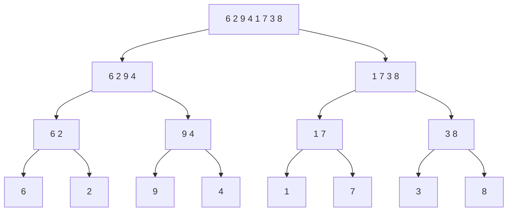

<Callout type="info" title="In one sentence">

Divide & conquer **splits** a problem into smaller copies of itself, **solves them recursively**, and
**combines** the answers. Merge sort splits the array in half, sorts each half, then merges two sorted
halves in linear time, for $\Theta(n\log n)$ in **every** case.

</Callout>

## Everyday analogy

**Sorting exam papers with friends.** You have 800 papers. Give half to each of two friends; they each
split *their* pile again, and so on, until each person holds one paper (already "sorted"). Then everyone
walks back up the chain: two people with sorted piles **merge** them by repeatedly taking the smaller top
sheet. Merging two sorted piles is fast, because you only ever look at the two top sheets.

## Key ideas

| Step | Merge sort | Cost |
|---|---|---|
| **Divide** | find the middle $q$ | $\Theta(1)$ |
| **Conquer** | sort `A[p..q]` and `A[q+1..r]` recursively | $2T(n/2)$ |
| **Combine** | `Merge` the two sorted halves | $\Theta(n)$ |

$$
T(n) = \begin{cases}\Theta(1) & n = 1\\ 2T(n/2) + \Theta(n) & n > 1\end{cases} \quad\Rightarrow\quad T(n) = \Theta(n\log n) \text{ (solved in Topic 8)}
$$

```text
MergeSort(A, p, r)
1  if p ≥ r then return                // 0 or 1 element: already sorted
2  q ← ⌊(p + r) / 2⌋
3  MergeSort(A, p, q)
4  MergeSort(A, q + 1, r)
5  Merge(A, p, q, r)

Merge(A, p, q, r)                      // A[p..q] and A[q+1..r] are each sorted
1  copy A[p..q] into L, A[q+1..r] into R
2  i ← 1; j ← 1; k ← p
3  while i ≤ |L| and j ≤ |R| do        // both piles still have cards
4      if L[i] ≤ R[j] then A[k] ← L[i]; i ← i + 1
5      else               A[k] ← R[j]; j ← j + 1
6      k ← k + 1
7  copy whatever is left in L or R into A[k..r]
```

**Tree facts used in the analysis** (complete $k$-ary tree): level $d$ has $k^d$ nodes, and a tree with
$n$ leaves has height $\log_k n$. For merge sort ($k = 2$): $\log_2 n$ splitting levels.

---

<Tabs groupId="study-mode" persist items={["Visual", "Worked example", "Guided questions", "Explanation & drill"]}>
<Tab value="Visual">

**Merge sort on `[6, 2, 9, 4, 1, 7, 3, 8]`** (our own example)



**Merging back up** (comparisons in brackets):

| Level | Merges | Result |
|---|---|---|
| size 2 | [6]+[2]→**2 6** (1) · [9]+[4]→**4 9** (1) · [1]+[7]→**1 7** (1) · [3]+[8]→**3 8** (1) | 4 comparisons |
| size 4 | [2 6]+[4 9]→**2 4 6 9** (3) · [1 7]+[3 8]→**1 3 7 8** (3) | 6 comparisons |
| size 8 | [2 4 6 9]+[1 3 7 8]→**1 2 3 4 6 7 8 9** (7) | 7 comparisons |

Total **17 comparisons**. Each level does at most $n = 8$ work, and there are $\log_2 8 = 3$ merge levels.

**Inside one merge:** `L = [2 4 6 9]`, `R = [1 3 7 8]`

| compare | take | output so far |
|---|---|---|
| 2 vs 1 | 1 (R) | 1 |
| 2 vs 3 | 2 (L) | 1 2 |
| 4 vs 3 | 3 (R) | 1 2 3 |
| 4 vs 7 | 4 (L) | 1 2 3 4 |
| 6 vs 7 | 6 (L) | 1 2 3 4 6 |
| 9 vs 7 | 7 (R) | 1 2 3 4 6 7 |
| 9 vs 8 | 8 (R) | 1 2 3 4 6 7 8 |
| R empty | copy 9 | 1 2 3 4 6 7 8 9 |

</Tab>
<Tab value="Worked example">

**Why is Merge linear?** Every comparison places exactly one element into the output, and there are $n$ elements in total. So there are at most $n - 1$ comparisons plus $n$ copies: $\Theta(n)$.

**Why is merge sort $\Theta(n\log n)$?** (A preview of [Topic 8](08-recurrences.mdx).)

| Level | Subproblems | Size each | Merge work per level |
|---|---|---|---|
| 0 | 1 | $n$ | $cn$ |
| 1 | 2 | $n/2$ | $2\cdot c\frac n2 = cn$ |
| 2 | 4 | $n/4$ | $cn$ |
| … | … | … | $cn$ |
| $\log_2 n$ | $n$ | 1 | $cn$ (base cases) |

There are $\log_2 n + 1$ levels, each costing $cn$, so $T(n) = cn\log_2 n + cn = \Theta(n\log n)$.

**Merge sort vs. insertion sort**

| | Insertion sort | Merge sort |
|---|---|---|
| Best case | $\Theta(n)$ | $\Theta(n\log n)$ |
| Worst case | $\Theta(n^2)$ | $\Theta(n\log n)$ |
| Extra space | $\Theta(1)$ (in place) | $\Theta(n)$ (arrays `L`, `R`) |
| Stable? | yes | yes (because of `≤` in line 4) |

</Tab>
<Tab value="Guided questions">

**Q1.** Why does `MergeSort` stop when `p ≥ r`?

<Accordions>
<Accordion title="✅ Answer">

Then the range has 0 or 1 elements, which is already sorted. This is the base case.

</Accordion>
</Accordions>

**Q2.** In `Merge`, why use `≤` rather than `<` when comparing `L[i]` and `R[j]`?

<Accordions>
<Accordion title="✅ Answer">

On a tie it takes from the **left** half first, which keeps equal elements in their original order (stability).

</Accordion>
</Accordions>

**Q3.** Correctness of `Merge`: what invariant does the while loop keep?

<Accordions>
<Accordion title="💡 Hint">

Describe `A[p..k-1]` (what's already been written) and how it relates to `L[i]` and `R[j]`.

</Accordion>
<Accordion title="✅ Answer">

`A[p..k-1]` holds the $k - p$ smallest elements of `L` and `R`, in sorted order, and `L[i]`, `R[j]` are the smallest elements not yet copied.

</Accordion>
</Accordions>

**Q4.** Binary search is also divide & conquer. What is its recurrence?

<Accordions>
<Accordion title="✅ Answer">

One half is searched and the other discarded: $T(n) = T(n/2) + \Theta(1)$, which gives $\Theta(\log n)$.

</Accordion>
</Accordions>

</Tab>
<Tab value="Explanation & drill">

**Explanation.** Divide & conquer pays off when the **combine** step is cheap compared with solving the whole problem directly. Insertion sort does up to $n$ work per element (quadratic). Merge sort only does $n$ work per **level**, and halving gives just $\log n$ levels. The price is $\Theta(n)$ extra memory for the merge. The running time of any D&C algorithm is naturally a **recurrence** (time expressed through smaller copies of itself), which [Topic 8](08-recurrences.mdx) teaches you to solve.

**Drill**

**1.** How many merge levels for $n = 32$?

<Accordions>
<Accordion title="✅ Answer">

$\log_2 32 = 5$

</Accordion>
</Accordions>

**2.** Maximum comparisons to merge two sorted lists of sizes 4 and 6?

<Accordions>
<Accordion title="✅ Answer">

$4 + 6 - 1 = 9$

</Accordion>
</Accordions>

**3.** Minimum comparisons for the same merge?

<Accordions>
<Accordion title="✅ Answer">

4: when every element of the smaller list is less than everything in the other, the shorter list empties after 4 comparisons.

</Accordion>
</Accordions>

**4.** Write the recurrence for an algorithm that splits into **3** parts of size $n/3$ and combines in linear time.

<Accordions>
<Accordion title="✅ Answer">

$T(n) = 3T(n/3) + \Theta(n)$

</Accordion>
</Accordions>

</Tab>
</Tabs>

---

## Common mistakes

- In a trace, merging *unsorted* halves. Always recurse all the way down first.
- Forgetting to copy the leftovers at the end of `Merge`.
- Saying merge sort is $\Theta(n)$ in the best case. It does the same splitting and merging on every input.
- Miscounting levels: there are $\log_2 n$ merge levels plus the leaf level, so $\log_2 n + 1$ levels in the tree.

## Mastery check

<Callout type="idea" title="Solve without hints, then explain">

Trace merge sort on `[5, 1, 4, 2, 8, 3]` (left half gets the extra element when splitting an odd size).
Show every merge and count the total comparisons.

</Callout>

<Accordions>
<Accordion title="✅ Answer">

Split: `[5 1 4] [2 8 3]` → `[5 1] [4]`, `[2 8] [3]` → singles.
Merges: `[5]+[1]→[1 5]` (1) · `[1 5]+[4]→[1 4 5]` (2) · `[2]+[8]→[2 8]` (1) · `[2 8]+[3]→[2 3 8]` (2) · `[1 4 5]+[2 3 8]→[1 2 3 4 5 8]` (5).
**Total 11 comparisons.**

</Accordion>
</Accordions>

## See it move

- [VisuAlgo: Sorting](https://visualgo.net/en/sorting): choose **MER** (merge sort).
- [VisuAlgo: Recursion tree](https://visualgo.net/en/recursion): watch the call tree grow.

## References

- 08 *Divide & Conquer, Recurrences*: Slides 3–4 (k-ary tree facts), 5 (D&C idea), 7–19 (merging step by step), 20–24 (MERGE and MERGE-SORT procedures), 25–29 (running time and recursion tree).
- CLRS 4e §2.3 (designing algorithms: merge sort), Appendix B.5 (trees).
