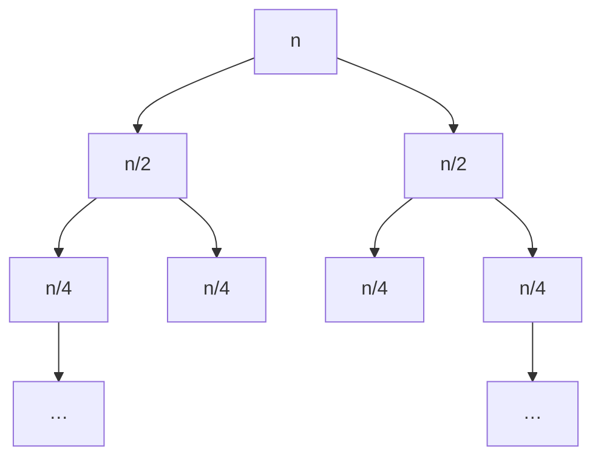

<Callout type="info" title="In one sentence">

A recurrence describes running time in terms of smaller inputs, e.g. $T(n) = 2T(n/2) + n$. Solve it by
**drawing the recursion tree**, **adding up the cost of each level**, and, when asked, **proving the guess
by induction** (the substitution method).

</Callout>

## Everyday analogy

**A company org chart.** The CEO does $f(n)$ work personally and hands the rest to $a$ managers, each
handling a $1/b$ share. They do the same with their teams, and so on down to the interns (the base cases).
The company's **total work** = the sum over every level of the chart. Ask yourself: *is most of the work done
at the top, at the bottom, or spread evenly?*

## Key tools

**Recursion-tree level table** for $T(n) = a\,T(n/b) + f(n)$:

| Level $i$ | # nodes | Size of each | Cost per node | Level total |
|---|---|---|---|---|
| 0 | 1 | $n$ | $f(n)$ | $f(n)$ |
| 1 | $a$ | $n/b$ | $f(n/b)$ | $a\,f(n/b)$ |
| $i$ | $a^i$ | $n/b^i$ | $f(n/b^i)$ | $a^i f(n/b^i)$ |
| last ($i = \log_b n$) | $a^{\log_b n} = n^{\log_b a}$ | 1 | $\Theta(1)$ | $\Theta(n^{\log_b a})$ |

**Then look at the level totals:**

| Level totals… | Then $T(n)$ is… | Example |
|---|---|---|
| **equal** on every level | level cost × number of levels | $2T(n/2) + n \Rightarrow \Theta(n\log n)$ |
| **shrinking** geometrically going down | dominated by the **root** | $2T(n/2) + n^2 \Rightarrow \Theta(n^2)$ |
| **growing** geometrically going down | dominated by the **leaves**, $\Theta(n^{\log_b a})$ | $4T(n/2) + n \Rightarrow \Theta(n^2)$ |

**Other methods**

- **Expansion (iteration):** substitute the recurrence into itself a few times, spot the pattern, then sum. Best for $T(n) = T(n-1) + \dots$
- **Substitution (guess and verify):** guess the answer (often from the tree), then prove it by induction ([Topic 2](02-proof-techniques.mdx)).
- **Master theorem** (CLRS §4.5): a shortcut for the three rows above. Not in the slides yet, so use it to *check* answers unless your instructor allows it.

---

<Tabs groupId="study-mode" persist items={["Visual", "Worked example", "Guided questions", "Explanation & drill"]}>
<Tab value="Visual">

**$T(n) = 2T(n/2) + n$** (merge sort)

| Level | nodes | size | level total |
|---|---|---|---|
| 0 | 1 | $n$ | $n$ |
| 1 | 2 | $n/2$ | $n$ |
| 2 | 4 | $n/4$ | $n$ |
| $\log_2 n$ | $n$ | 1 | $n$ |

Equal levels: $n \times (\log_2 n + 1)$ levels, so $\Theta(n\log n)$.

---

**$T(n) = 2T(n/2) + n^2$**: the root dominates

| Level | nodes | size | level total |
|---|---|---|---|
| 0 | 1 | $n$ | $n^2$ |
| 1 | 2 | $n/2$ | $2\cdot\frac{n^2}{4} = \frac{n^2}{2}$ |
| 2 | 4 | $n/4$ | $\frac{n^2}{4}$ |

The totals halve each level: $n^2(1 + \frac12 + \frac14 + \dots) \le 2n^2$, so $\Theta(n^2)$.

---

**$T(n) = 4T(n/2) + n$**: the leaves dominate

Level totals $n, 2n, 4n, \dots$ double going down. The leaves: $4^{\log_2 n} = n^{\log_2 4} = n^2$, so $\Theta(n^2)$.

</Tab>
<Tab value="Worked example">

**A. Expansion:** $T(n) = T(n-1) + n$, $T(1) = 1$.

$$
\begin{aligned}
T(n) &= T(n-1) + n\\
     &= T(n-2) + (n-1) + n\\
     &= T(n-3) + (n-2) + (n-1) + n\\
     &\;\;\vdots\\
     &= T(1) + 2 + 3 + \dots + n = \frac{n(n+1)}{2}
\end{aligned}
$$

So $\Theta(n^2)$. This is the recurrence of insertion sort's worst case written recursively.

**B. Recursion tree with an uneven split:** $T(n) = T(n/2) + T(n/4) + n$.

| Level | pieces | level total |
|---|---|---|
| 0 | $n$ | $n$ |
| 1 | $\frac n2, \frac n4$ | $\frac34 n$ |
| 2 | $\frac n4, \frac n8, \frac n8, \frac n{16}$ | $\frac{9}{16}n$ |

Each level is $\frac34$ of the one above, a shrinking geometric series: $n \cdot \frac{1}{1 - 3/4} = 4n$, so $\Theta(n)$.

**C. Substitution (prove the guess):** show $T(n) = 2T(n/2) + n$ satisfies $T(n) \le c\,n\log_2 n$ for $n \ge 2$ (take $n$ a power of 2).

- **Hypothesis:** $T(n/2) \le c\frac n2\log_2\frac n2$.
- **Step:**
$$
T(n) \le 2\cdot c\frac n2\log_2\frac n2 + n = cn(\log_2 n - 1) + n = cn\log_2 n - cn + n \le cn\log_2 n \quad\text{if } c \ge 1.
$$
- **Base:** with $T(1) = 1$, we get $T(2) = 4 \le c\cdot2\log_2 2 = 2c$, so choose $c \ge 2$. With $c = 2$ both conditions hold, so $T(n) = O(n\log n)$ ∎

</Tab>
<Tab value="Guided questions">

**Q1.** In $T(n) = 3T(n/3) + n$, how many nodes are at level $i$, and how big is each?

<Accordions>
<Accordion title="✅ Answer">

$3^i$ nodes, each of size $n/3^i$, so each level costs $3^i\cdot\frac{n}{3^i} = n$.

</Accordion>
</Accordions>

**Q2.** How many levels does that tree have?

<Accordions>
<Accordion title="💡 Hint">

When does $n/3^i$ reach 1?

</Accordion>
<Accordion title="✅ Answer">

$i = \log_3 n$, so $\log_3 n + 1$ levels. Total: $n(\log_3 n + 1) = \Theta(n\log n)$.

</Accordion>
</Accordions>

**Q3.** $T(n) = T(n/2) + 1$. What algorithm is this, and what's the answer?

<Accordions>
<Accordion title="✅ Answer">

Binary search. One node per level, $\log_2 n + 1$ levels of cost 1, so $\Theta(\log n)$.

</Accordion>
</Accordions>

**Q4.** $T(n) = 2T(n/2) + 1$. Root-heavy or leaf-heavy?

<Accordions>
<Accordion title="✅ Answer">

Level totals are $1, 2, 4, \dots, n$, growing, so the leaves dominate: $\Theta(n)$ (exactly $2n - 1$ when $n$ is a power of 2).

</Accordion>
</Accordions>

</Tab>
<Tab value="Explanation & drill">

**Explanation.** A recursive algorithm's cost is "my own work + the cost of my recursive calls", which is exactly a recurrence. The recursion tree turns this into a **sum over levels**. The two numbers you must get right are **how many nodes per level** ($a^i$) and **how big each node is** ($n/b^i$). Multiply them with $f$ to get each level's total, then decide whether those totals are equal, shrinking or growing. Equal means multiply by the number of levels ($\approx\log n$). Shrinking means the top level wins. Growing means the bottom level wins. If a proof is required, use the tree's answer as your guess and verify it by induction.

**Drill:** give $\Theta(\cdot)$.

**1.** $T(n) = T(n/2) + n$

<Accordions>
<Accordion title="✅ Answer">

$n + \frac n2 + \frac n4 + \dots \le 2n$, so $\Theta(n)$

</Accordion>
</Accordions>

**2.** $T(n) = 2T(n/4) + n$

<Accordions>
<Accordion title="✅ Answer">

Level totals $n, \frac n2, \frac n4, \dots$ shrink, so $\Theta(n)$

</Accordion>
</Accordions>

**3.** $T(n) = 8T(n/2) + n^2$

<Accordions>
<Accordion title="✅ Answer">

Level totals $n^2, 2n^2, 4n^2, \dots$ grow, leaves $8^{\log_2 n} = n^3$, so $\Theta(n^3)$

</Accordion>
</Accordions>

**4.** $T(n) = T(n-1) + 1$

<Accordions>
<Accordion title="✅ Answer">

$\Theta(n)$ by expansion.

</Accordion>
</Accordions>

**5.** $T(n) = 4T(n/2) + n^2$

<Accordions>
<Accordion title="✅ Answer">

Each level costs $4^i\cdot(n/2^i)^2 = n^2$ (equal) over $\log_2 n + 1$ levels, so $\Theta(n^2\log n)$

</Accordion>
</Accordions>

</Tab>
</Tabs>

---

## Common mistakes

- Writing the level total as $f(n/b^i)$ and forgetting to multiply by the **number of nodes** $a^i$.
- Wrong number of levels: it's $\log_b n$ (where the size reaches 1), not $\log_a n$.
- Forgetting the leaves' cost $n^{\log_b a}$ when levels grow.
- In substitution: proving $T(n) \le cn\log n + n$ and calling it done. You must get back to **exactly** $\le cn\log n$ with the **same** $c$.
- Using $\log$ rules wrongly: $\log_2(n/2) = \log_2 n - 1$, **not** $\frac{\log_2 n}{2}$.

## Mastery check

<Callout type="idea" title="Solve without hints, then explain level by level">

(a) Solve $T(n) = 3T(n/3) + n$ with a recursion tree (build the full level table).

(b) Solve $T(n) = 2T(n/2) + n^2$ and say why the root dominates.

(c) Solve $T(n) = T(n-1) + 2$, $T(1) = 0$, by expansion.

</Callout>

<Accordions>
<Accordion title="✅ Answers">

(a) $3^i$ nodes × $n/3^i$ = $n$ per level over $\log_3 n + 1$ levels, so $\Theta(n\log n)$.

(b) Level totals $n^2, \frac{n^2}{2}, \frac{n^2}{4}, \dots$ form a shrinking series, sum $\le 2n^2$, so $\Theta(n^2)$.

(c) $T(n) = 2(n-1)$, so $\Theta(n)$.

</Accordion>
</Accordions>

<MasteryTracker topic="08-recurrences" />

## See it move

- [VisuAlgo: Recursion tree](https://visualgo.net/en/recursion): enter a recursive function and watch the tree.

## References

- 08 *Divide & Conquer, Recurrences*: Slides 25–29 (merge sort recurrence and full recursion tree), 30–33 (techniques, recursion-tree method), 34–42 (worked recursion-tree examples, including an uneven split).
- *Supplementary Notes: Proof techniques* p. 6 (verifying a recurrence's closed form by induction).
- CLRS 4e §4.3 (substitution method), §4.4 (recursion-tree method), §4.5 (master method, a preview), Appendix A (geometric series).
