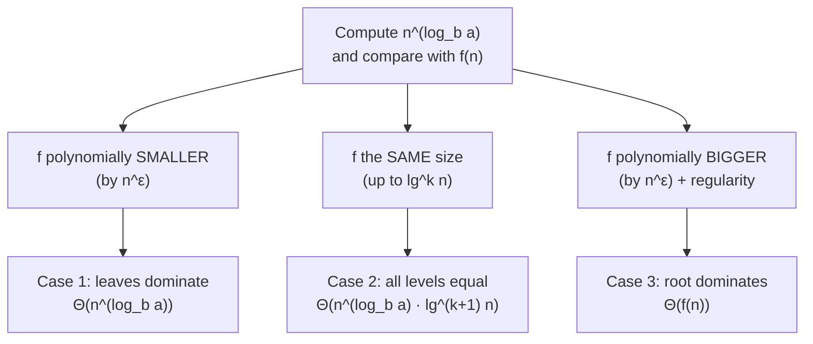

<Callout type="info" title="In one sentence">

The **iteration method** unrolls $T(n)$ until a pattern appears and then sums it with a known series. The
**master method** skips the work for $T(n) = a\,T(n/b) + f(n)$: compare $f(n)$ with $n^{\log_b a}$, and
the bigger one (or both, if they tie) decides the answer.

</Callout>

## Everyday analogy

**A tug-of-war between the boss and the interns.** In the org chart from [Topic 8](08-recurrences.mdx),
$f(n)$ is the work the boss does at the top and $n^{\log_b a}$ is the total work of all the interns at the bottom.
If the interns' side is polynomially bigger, they win (case 1). If the boss is polynomially bigger, the boss
wins (case 3). If it is a tie, every level of management pulls equally hard, so you pay the tie amount once
**per level**, an extra $\log n$ (case 2).

## Key ideas

**Iteration method (also called expansion).** Substitute the recurrence into itself $k$ times, write the
general $k$-th line, pick $k$ so the argument hits the base case, then sum.

| Recurrence | After $k$ substitutions | Stop when | Answer |
|---|---|---|---|
| $2T(n/2) + n$ | $2^k T(n/2^k) + kn$ | $n = 2^k$, so $k = \log_2 n$ | $n\,T(1) + n\log_2 n = \Theta(n\log n)$ |
| $3T(n/4) + n$ | $3^k T(n/4^k) + n\sum_{i=0}^{k-1}(3/4)^i$ | $n = 4^k$, so $k = \log_4 n$ | $4n - 3n^{\log_4 3} = \Theta(n)$ |

Two facts do most of the algebra:

- $a^{\log_b n} = n^{\log_b a}$ (swap base and exponent), so $3^{\log_4 n} = n^{\log_4 3} \approx n^{0.79}$.
- Geometric series: $\displaystyle\sum_{i=0}^{m} x^i = \frac{x^{m+1} - 1}{x - 1}$ for $x \ne 1$ ([Topic 0](00-math-toolkit.mdx)).

**The master theorem** (CLRS §4.5). For $T(n) = a\,T(n/b) + f(n)$ with $a \ge 1$, $b > 1$ and $f$
asymptotically positive, compute the **watershed** $n^{\log_b a}$ (the leaves' total) and compare:

| Case | Condition on $f(n)$ | In words | $T(n)$ |
|---|---|---|---|
| **1** | $f(n) = O(n^{\log_b a - \varepsilon})$ for some $\varepsilon > 0$ | $f$ is **polynomially smaller**; leaves win | $\Theta(n^{\log_b a})$ |
| **2** | $f(n) = \Theta(n^{\log_b a}\lg^k n)$ for some $k \ge 0$ | about the **same size**; every level ties | $\Theta(n^{\log_b a}\lg^{k+1} n)$ |
| **3** | $f(n) = \Omega(n^{\log_b a + \varepsilon})$ for some $\varepsilon > 0$, **and** $a f(n/b) \le c f(n)$ for some $c < 1$ | $f$ is **polynomially bigger**; root wins | $\Theta(f(n))$ |

The extra condition in case 3 is the **regularity condition**: the level totals really do shrink going down.
These three cases are exactly the *growing / equal / shrinking* level totals from [Topic 8](08-recurrences.mdx).

---

<Tabs groupId="study-mode" persist items={["Visual", "Worked example", "Guided questions", "Explanation & drill"]}>
<Tab value="Visual">

**Where the work sits**, for $T(n) = a\,T(n/b) + f(n)$:

**One family, three cases** (the lecture's examples, $a = 4$, $b = 2$, so $n^{\log_2 4} = n^2$):

| Recurrence | $f(n)$ vs $n^2$ | Level totals going down | Case | $T(n)$ |
|---|---|---|---|---|
| $4T(n/2) + n$ | $n = O(n^{2-1})$ | $n, 2n, 4n, \dots$ grow | 1 | $\Theta(n^2)$ |
| $4T(n/2) + n^2$ | $n^2 = \Theta(n^2\lg^0 n)$ | $n^2, n^2, n^2, \dots$ equal | 2 ($k = 0$) | $\Theta(n^2\lg n)$ |
| $4T(n/2) + n^3$ | $n^3 = \Omega(n^{2+1})$ | $n^3, \frac{n^3}{2}, \frac{n^3}{4}, \dots$ shrink | 3 | $\Theta(n^3)$ |

For the last row the regularity check is $4(n/2)^3 = \frac12 n^3 \le c\,n^3$ with $c = \frac12 < 1$. ✔

---

**Iteration of $T(n) = 3T(n/4) + n$, drawn as a tree:**

| Level $i$ | nodes | size | level total |
|---|---|---|---|
| 0 | 1 | $n$ | $n$ |
| 1 | 3 | $n/4$ | $\frac34 n$ |
| 2 | 9 | $n/16$ | $\frac{9}{16} n$ |
| $i$ | $3^i$ | $n/4^i$ | $(\frac34)^i n$ |
| leaves ($i = \log_4 n$) | $3^{\log_4 n} = n^{\log_4 3}$ | 1 | $n^{\log_4 3}$ |

The totals shrink by $\frac34$ each level, so the root's $n$ dominates: $\Theta(n)$.

</Tab>
<Tab value="Worked example">

**A. Iteration: $T(n) = 3T(n/4) + n$, $T(1) = 1$, $n$ a power of 4.**

$$
\begin{aligned}
T(n) &= 3T(n/4) + n\\
     &= 3\big(3T(n/16) + \tfrac n4\big) + n = 9T(n/16) + \tfrac34 n + n\\
     &= 27T(n/64) + \tfrac{9}{16}n + \tfrac34 n + n\\
     &\;\;\vdots\\
     &= 3^k T(n/4^k) + n\sum_{i=0}^{k-1}\left(\tfrac34\right)^i
\end{aligned}
$$

Stop at $n = 4^k$, so $k = \log_4 n$ and $3^k = 3^{\log_4 n} = n^{\log_4 3}$:

$$
T(n) = n^{\log_4 3}\cdot T(1) + n\cdot\frac{(3/4)^{\log_4 n} - 1}{3/4 - 1}.
$$

Since $(3/4)^{\log_4 n} = n^{\log_4 3 - 1} = \dfrac{n^{\log_4 3}}{n}$, the fraction is $4\left(1 - \dfrac{n^{\log_4 3}}{n}\right)$, so

$$
T(n) = n^{\log_4 3} + 4n - 4n^{\log_4 3} = 4n - 3n^{\log_4 3}.
$$

With $\log_4 3 \approx 0.79$: $T(n) = 4n - 3n^{0.79} = \Theta(n)$. Check: $T(4) = 3\cdot1 + 4 = 7$ and $4\cdot4 - 3\cdot3 = 7$. ✔

---

**B. Master method, step by step: $T(n) = 9T(n/3) + n$.**

1. Read off $a = 9$, $b = 3$, $f(n) = n$.
2. Watershed: $n^{\log_3 9} = n^2$.
3. Compare: $f(n) = n = O(n^{2-\varepsilon})$ with $\varepsilon = 1$, polynomially smaller.
4. Case 1: $T(n) = \Theta(n^2)$.

**C. Case 2 with $k = 1$: $T(n) = 2T(n/2) + n\lg n$.**

$a = 2$, $b = 2$, watershed $n$. $f(n) = n\lg n = \Theta(n^{1}\lg^1 n)$, so case 2 with $k = 1$: $T(n) = \Theta(n\lg^2 n)$.

**D. When the master theorem does not apply.**

- $T(n) = 2T(n/2) + \dfrac{n}{\lg n}$: $f$ is smaller than $n$ but only by a log factor, **not** by any $n^\varepsilon$, and it is not $n\lg^k n$ with $k \ge 0$. This falls in the gap between cases 1 and 2, so use a recursion tree instead.
- $T(n) = T(n/3) + T(2n/3) + n$: two **different** sizes, so it is not of the form $aT(n/b)$. Use a recursion tree ([Topic 8](08-recurrences.mdx)): every full level costs $n$ and the longest path has $\log_{3/2} n$ levels, so $\Theta(n\log n)$.
- $T(n) = T(n-1) + n$: subtracts instead of divides, so use iteration ([Topic 8](08-recurrences.mdx)).

</Tab>
<Tab value="Guided questions">

**Q1.** In $T(n) = 2T(n/2) + n$, unroll three times. What does the $k$-th line look like?

<Accordions>
<Accordion title="💡 Hint">

Each unroll doubles the number of $T$ terms, halves their argument, and adds another $n$.

</Accordion>
<Accordion title="✅ Answer">

$T(n) = 2^k T(n/2^k) + kn$. With $k = \log_2 n$: $n\,T(1) + n\log_2 n = \Theta(n\log n)$, the same answer as merge sort's recursion tree.

</Accordion>
</Accordions>

**Q2.** Why is $3^{\log_4 n}$ the same as $n^{\log_4 3}$?

<Accordions>
<Accordion title="✅ Answer">

Take $\log_4$ of both: $\log_4 n\cdot\log_4 3$ on each side. Equal logs mean equal numbers. In general $a^{\log_b n} = n^{\log_b a}$.

</Accordion>
</Accordions>

**Q3.** For $T(n) = 8T(n/2) + n^2$, which case applies?

<Accordions>
<Accordion title="💡 Hint">

Watershed: $n^{\log_2 8}$.

</Accordion>
<Accordion title="✅ Answer">

$n^{\log_2 8} = n^3$, and $f(n) = n^2 = O(n^{3-1})$. Case 1: $\Theta(n^3)$.

</Accordion>
</Accordions>

**Q4.** $T(n) = T(n/2) + 1$ (binary search). Which case, and what is $k$?

<Accordions>
<Accordion title="✅ Answer">

$a = 1$, $b = 2$: watershed $n^{\log_2 1} = n^0 = 1$. $f(n) = 1 = \Theta(1\cdot\lg^0 n)$, so case 2 with $k = 0$: $\Theta(\lg n)$.

</Accordion>
</Accordions>

**Q5.** Case 3 needs one more check. For $T(n) = 2T(n/2) + n^2$, is it satisfied?

<Accordions>
<Accordion title="✅ Answer">

Regularity: $2(n/2)^2 = \frac12 n^2 \le c\,n^2$ with $c = \frac12 < 1$. ✔ So $\Theta(n^2)$.

</Accordion>
</Accordions>

</Tab>
<Tab value="Explanation & drill">

**Explanation.** Every recurrence of the form $aT(n/b) + f(n)$ has two competing costs: the work at the root,
$f(n)$, and the total work at the leaves, $n^{\log_b a}$ (there are that many leaves, each costing $\Theta(1)$).
The master theorem just says *whichever is polynomially bigger wins*, and if they are the same size you pay
that amount on each of the $\Theta(\log n)$ levels. "Polynomially" matters: the gap has to be at least a factor
$n^\varepsilon$, so a mere $\log n$ difference is case 2 (when $f$ is the bigger one) or not covered at all
(when $f$ is the smaller one). When the theorem does not apply, fall back on iteration or a recursion tree:
both always work, they just take more algebra.

**Drill:** give $\Theta(\cdot)$ and name the case.

**1.** $T(n) = 2T(n/2) + 1$

<Accordions>
<Accordion title="✅ Answer">

Watershed $n$, $f = 1 = O(n^{1-1})$. Case 1: $\Theta(n)$.

</Accordion>
</Accordions>

**2.** $T(n) = 3T(n/2) + n^2$

<Accordions>
<Accordion title="✅ Answer">

Watershed $n^{\log_2 3} \approx n^{1.58}$. $f = n^2 = \Omega(n^{1.58 + 0.4})$, and $3(n/2)^2 = \frac34 n^2$, so regularity holds. Case 3: $\Theta(n^2)$.

</Accordion>
</Accordions>

**3.** $T(n) = 16T(n/4) + n^2$

<Accordions>
<Accordion title="✅ Answer">

Watershed $n^{\log_4 16} = n^2 = f$. Case 2 ($k = 0$): $\Theta(n^2\lg n)$.

</Accordion>
</Accordions>

**4.** $T(n) = 7T(n/2) + n^2$ (Strassen)

<Accordions>
<Accordion title="✅ Answer">

Watershed $n^{\log_2 7} \approx n^{2.81}$, $f = n^2 = O(n^{2.81 - 0.8})$. Case 1: $\Theta(n^{\log_2 7})$.

</Accordion>
</Accordions>

**5.** $T(n) = 4T(n/2) + n^2\lg n$

<Accordions>
<Accordion title="✅ Answer">

Watershed $n^2$, $f = \Theta(n^2\lg^1 n)$. Case 2 with $k = 1$: $\Theta(n^2\lg^2 n)$.

</Accordion>
</Accordions>

</Tab>
</Tabs>

---

## Common mistakes

- Comparing $f(n)$ with $n^{\log_a b}$: the watershed is $n^{\log_{\boldsymbol b} \boldsymbol a}$ (log base $b$ of $a$).
- Calling $n\lg n$ vs $n$ "case 3". A log factor is **not** polynomial; $n\lg n = \Theta(n\lg^1 n)$ is case 2 with $k = 1$.
- Forgetting the regularity condition in case 3.
- Forcing the master theorem onto $T(n-1)$, uneven splits like $T(n/3) + T(2n/3)$, or $f = n/\lg n$. Use iteration or a tree.
- In iteration, summing the geometric series with the wrong number of terms. Write the $k$-th line first, then plug in $k$.
- Losing the leaves: after iterating, $a^k T(1)$ is $n^{\log_b a}$, not $n$.

## Mastery check

<Callout type="idea" title="Solve without hints, then explain which side wins and why">

(a) Use the iteration method to solve $T(n) = 2T(n/2) + n$, $T(1) = 1$ ($n$ a power of 2). Give the exact closed form.

(b) Use the master method on $T(n) = 9T(n/3) + n^3$. State $a$, $b$, the watershed, the case and every condition you checked.

(c) Use the master method on $T(n) = 3T(n/4) + n\lg n$.

</Callout>

<Accordions>
<Accordion title="✅ Answers">

(a) $T(n) = 2^kT(n/2^k) + kn$; with $k = \log_2 n$: $T(n) = n + n\log_2 n$, so $\Theta(n\log n)$.

(b) $a = 9$, $b = 3$, watershed $n^2$. $f = n^3 = \Omega(n^{2+1})$, and $9(n/3)^3 = \frac13 n^3 \le \frac13 n^3$, so regularity holds with $c = \frac13$. Case 3: $\Theta(n^3)$.

(c) $a = 3$, $b = 4$, watershed $n^{\log_4 3} \approx n^{0.79}$. $f = n\lg n = \Omega(n^{0.79 + 0.2})$. Regularity: $3\cdot\frac n4\lg\frac n4 \le \frac34 n\lg n$, so $c = \frac34$. Case 3: $\Theta(n\lg n)$.

</Accordion>
</Accordions>

<MasteryTracker topic="09-master-method" />

## See it move

- [VisuAlgo: Recursion tree](https://visualgo.net/en/recursion): try `4T(n/2) + n`, then `+ n*n`, then `+ n*n*n` and watch where the work piles up.

## References

- 06 *Solving Recurrences (Part II)*: Slides 2 (recap), 3–5 (iteration method on merge sort), 6–9 (iteration on $3T(n/4) + n$), 10–12 (master method and its three cases), 13–15 (examples $4T(n/2) + n,\ n^2,\ n^3$), 16 (proof reading).
- 05b *Recursion Trees Examples*: p. 2 (the uneven $T(n/3) + T(2n/3) + n$ tree).
- CLRS 4e §4.5 (master method), §4.6 (proof of the master theorem), Appendix A.1 (geometric series), §3.3 (logarithm identities).
