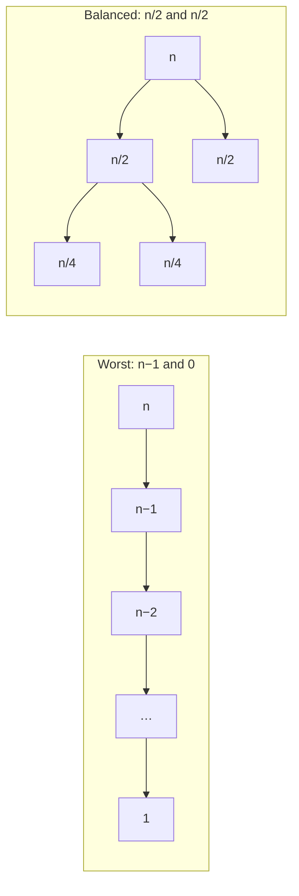

<Callout type="info" title="In one sentence">

**Partition** puts one pivot in its final sorted position with smaller items on its left and larger on its right
in $\Theta(n)$. **Quicksort** partitions and then recurses on **both** sides ($\Theta(n\log n)$ on average,
$\Theta(n^2)$ in the worst case). **Selection** partitions and recurses on **one** side only, so it finds the
$i$-th smallest in expected $\Theta(n)$ (and worst-case $\Theta(n)$ with median-of-medians).

</Callout>

## Everyday analogy

**Lining up a class by height without a tape measure.** Pick one student as the *pivot*. Everyone shorter
steps to the left of them and everyone taller to the right. The pivot is now standing in exactly the spot they
would have in the sorted line. To sort the whole class, repeat on each side (quicksort). To find *only* the
5th-shortest student, look where the pivot ended up and repeat on **just the one side** that contains spot 5
(selection). You never need to sort the other side.

## Key ideas

```text
Quicksort(A, p, r)
1  if p < r
2      q ← Partition(A, p, r)        // pivot ends up in A[q]
3      Quicksort(A, p, q − 1)        // low side
4      Quicksort(A, q + 1, r)        // high side

Partition(A, p, r)                   // Lomuto: the pivot is the LAST element
1  x ← A[r]
2  i ← p − 1                         // end of the "≤ x" zone
3  for j ← p to r − 1
4      if A[j] ≤ x
5          i ← i + 1
6          exchange A[i] with A[j]
7  exchange A[i + 1] with A[r]       // drop the pivot between the zones
8  return i + 1
```

**Partition's loop invariant.** At the start of each iteration: `A[p..i]` are all $\le x$, `A[i+1..j−1]`
are all $> x$, and `A[r]` $= x$. Partition makes exactly $n - 1$ comparisons on $n$ elements, so it is $\Theta(n)$.

| Quicksort case | Split each time | Recurrence | $T(n)$ |
|---|---|---|---|
| **Worst** (already sorted, last-element pivot) | $n-1$ and $0$ | $T(n-1) + \Theta(n)$ | $\Theta(n^2)$ |
| **Best** | about $n/2$ and $n/2$ | $2T(n/2) + \Theta(n)$ | $\Theta(n\log n)$ |
| **Lopsided but constant-ratio**, e.g. 9 : 1 | $\frac{9n}{10}$ and $\frac{n}{10}$ | $T(\frac{9n}{10}) + T(\frac{n}{10}) + cn$ | $\Theta(n\log n)$ |
| **Randomized pivot** (expected) | random | | $\Theta(n\log n)$ expected for **every** input |

Quicksort is **in place** (no extra array, unlike merge sort) but **not stable** (equal keys can swap order).
Merge sort does its work while *combining*; quicksort does it while *dividing* and has nothing left to combine.

**Selection.** Find the $i$-th smallest of $n$ items (min: $i = 1$, max: $i = n$, median: $i \approx n/2$).
Partition, let $k$ = the pivot's rank in the current subarray, then:

$$
\text{Select}(A, i) = \begin{cases}
\text{the pivot} & i = k\\
\text{Select}(\text{low side}, i) & i < k\\
\text{Select}(\text{high side}, i - k) & i > k
\end{cases}
$$

| Selection algorithm | Pivot choice | Worst case | Expected |
|---|---|---|---|
| Randomized-Select (quick-select) | random | $\Theta(n^2)$ | $\Theta(n)$ |
| Select (median of medians) | median of the group-of-5 medians | $\Theta(n)$ | $\Theta(n)$ |

---

<Tabs groupId="study-mode" persist items={["Visual", "Worked example", "Guided questions", "Explanation & drill"]}>
<Tab value="Visual">

**Partition `[2, 8, 7, 1, 3, 5, 6, 4]`** (indices 1–8, pivot $x = A[8] = 4$, shown as `[4]`). Bold = the "≤ 4" zone.

| Step | $j$ | $A[j] \le 4$? | $i$ | Array after the step |
|---|---|---|---|---|
| start | – | – | 0 | `2 8 7 1 3 5 6 [4]` |
| 1 | 1 | 2 ✔ swap $A[1]$, $A[1]$ | 1 | **`2`** `8 7 1 3 5 6 [4]` |
| 2 | 2 | 8 ✘ | 1 | **`2`** `8 7 1 3 5 6 [4]` |
| 3 | 3 | 7 ✘ | 1 | **`2`** `8 7 1 3 5 6 [4]` |
| 4 | 4 | 1 ✔ swap $A[2]$, $A[4]$ | 2 | **`2 1`** `7 8 3 5 6 [4]` |
| 5 | 5 | 3 ✔ swap $A[3]$, $A[5]$ | 3 | **`2 1 3`** `8 7 5 6 [4]` |
| 6 | 6 | 5 ✘ | 3 | **`2 1 3`** `8 7 5 6 [4]` |
| 7 | 7 | 6 ✘ | 3 | **`2 1 3`** `8 7 5 6 [4]` |
| end | | swap $A[4]$, $A[8]$ | | **`2 1 3`** `4` `7 5 6 8` |

Returns $q = 4$: the pivot 4 is in its final position, with **7 comparisons** ($n - 1$).

---

**Quicksort's worst case vs a good split** (cost per level of the recursion tree):



Worst: $n$ levels costing $n, n-1, \dots, 1$, total $\frac{n(n+1)}{2} = \Theta(n^2)$. Balanced: $\log n$ levels of $\le n$, total $\Theta(n\log n)$.

---

**Median of medians** (choosing a guaranteed-good pivot):

1. Split the $n$ items into groups of 5 and find each group's median by brute force.
2. Recursively find $x$ = the median of those $\lfloor n/5\rfloor$ medians.
3. At least half the group medians are $\le x$, and each of those has 2 more items below it in its group, so **at least $3\lfloor n/10\rfloor$ items are $\le x$** (and likewise $\ge x$).
4. For $n \ge 50$ that is at least $n/4$, so the recursive call gets **at most $3n/4$** items.

$$
T(n) \le T(n/5) + T(3n/4) + \Theta(n), \qquad \tfrac15 + \tfrac34 = \tfrac{19}{20} < 1 \;\Rightarrow\; T(n) = \Theta(n).
$$

</Tab>
<Tab value="Worked example">

**A. Randomized-Select idea on the lecture's example.** Find the 4th smallest ($i = 4$). Suppose the pivot is 4
and partition gives `[3, 1, 2, 4, 6, 9, 5, 7]` with $q = 4$. The low side `[3, 1, 2]` has 3 items, so the pivot's
rank is $k = 4 = i$: **answer 4**, done after one partition. If $i$ were 2 we would recurse on `[3, 1, 2]`
only; if $i$ were 6 we would look for the $6 - 4 = 2$nd smallest in `[6, 9, 5, 7]`.

**B. Select the 3rd smallest of `[5, 3, 8, 1, 9, 2, 7]`** (always pivot on the last element, so you can trace it):

| Call | Subarray | Pivot | After partition | Pivot rank $k$ | Next |
|---|---|---|---|---|---|
| 1 | `5 3 8 1 9 2 7`, $i = 3$ | 7 | `5 3 1 2` **7** `8 9` | 5 | $3 < 5$: go left, $i = 3$ |
| 2 | `5 3 1 2`, $i = 3$ | 2 | `1` **2** `5 3` | 2 | $3 > 2$: go right, $i = 3 - 2 = 1$ |
| 3 | `5 3`, $i = 1$ | 3 | **3** `5` | 1 | $i = k$: **answer 3** |

Check: sorted is `1 2 3 5 7 8 9`, and the 3rd smallest is 3. ✔ Notice we never sorted `8 9` or `5`.

**C. Why randomized selection is linear on average** (the lecture's "good splitter" argument). Call a pivot
*good* if at least $n/4$ items are on each side, which is true whenever it lands in the middle half. Then the side we recurse
on has at most $3n/4$ items:

$$
T(n) \le T(3n/4) + cn \le cn + \tfrac34 cn + \left(\tfrac34\right)^2 cn + \dots = 4cn = O(n).
$$

A random pivot is good half the time, so on average it takes about 2 partitions to get one good split. That only
doubles the constant, so the expected time is still $O(n)$.

**D. Nuts and bolts.** You have $n$ nuts and $n$ bolts, each nut fits exactly one bolt, and you can only compare
a nut **with a bolt** (too big / too small / fits), never nut with nut or bolt with bolt.

- *Brute force:* for each bolt, try nuts until one fits: up to $n$ tries each, $O(n^2)$.
- *Divide & conquer (quicksort-style):*
  1. Pick a bolt $B$ as the pivot and **partition the nuts** around it: smaller nuts left, bigger right, and the matching nut $N$ in the middle.
  2. Use that nut $N$ to **partition the bolts**: smaller bolts left, bigger right, $B$ in the middle.
  3. Now $N$ and $B$ sit at the same index. Recurse on the left halves together and the right halves together.

Each round does $\Theta(n)$ comparisons, exactly like quicksort, so it runs in $\Theta(n\log n)$ expected with
random pivots (worst case $\Theta(n^2)$). The trick: you can't compare nuts with each other, but **a nut and its
own bolt are the same size**, so each one can act as the pivot for the other pile.

</Tab>
<Tab value="Guided questions">

**Q1.** Partition always ends with `exchange A[i+1] with A[r]`. Why is $i + 1$ the right spot for the pivot?

<Accordions>
<Accordion title="💡 Hint">

Use the invariant: what is in `A[p..i]` and in `A[i+1..r−1]` when the loop ends?

</Accordion>
<Accordion title="✅ Answer">

When the loop ends, `A[p..i]` are all $\le x$ and `A[i+1..r−1]` are all $> x$. So exactly $i - p + 1$ items are $\le x$, and the pivot belongs right after them. Swapping it with the first "$>x$" item keeps both zones intact.

</Accordion>
</Accordions>

**Q2.** You run quicksort (last-element pivot) on an array that is already sorted. What happens at every step?

<Accordions>
<Accordion title="✅ Answer">

The pivot is the largest item, so the split is $n-1$ and $0$ every time. $T(n) = T(n-1) + \Theta(n) = \Theta(n^2)$, which is $\frac{n(n-1)}{2}$ comparisons. Insertion sort would take only $\Theta(n)$ on the same input.

</Accordion>
</Accordions>

**Q3.** A 99 : 1 split still gives $\Theta(n\log n)$. Why doesn't the bad ratio matter?

<Accordions>
<Accordion title="💡 Hint">

Draw the recursion tree. What does each full level cost, and how deep is it?

</Accordion>
<Accordion title="✅ Answer">

Each level costs at most $cn$, and the deepest path shrinks by a factor $\frac{99}{100}$ per level, so it has $\log_{100/99} n = \Theta(\log n)$ levels. Any **constant** ratio gives $\Theta(n\log n)$; only splits like $n-1$ : $0$ that don't shrink by a constant factor are bad.

</Accordion>
</Accordions>

**Q4.** Selection recurses on one side and quicksort on two. Why does that change $n\log n$ into $n$?

<Accordions>
<Accordion title="✅ Answer">

With good splits, quicksort's levels each cost about $n$ (all pieces together), over $\log n$ levels. Selection keeps only one piece, so the level costs are $n, \frac34 n, (\frac34)^2 n, \dots$, a shrinking geometric series whose sum is $O(n)$ (the root dominates, as in [Topic 8](08-recurrences.mdx)).

</Accordion>
</Accordions>

**Q5.** In median of medians, why groups of 5 and not 3?

<Accordions>
<Accordion title="✅ Answer">

With groups of 3, only about $n/3$ items are guaranteed on each side, so the recurrence becomes $T(n/3) + T(2n/3) + \Theta(n)$. The fractions add up to exactly 1, and every level costs $n$, so the answer is $\Theta(n\log n)$, not linear. Groups of 5 give $\frac15 + \frac34 = \frac{19}{20} < 1$.

</Accordion>
</Accordions>

</Tab>
<Tab value="Explanation & drill">

**Explanation.** Partition is the whole engine: one pass, $n-1$ comparisons, and the pivot lands in its final
place. Quicksort's speed depends entirely on **where** the pivot lands. Splits that keep a constant fraction on
each side give $\Theta(n\log n)$, and always-extreme pivots give $\Theta(n^2)$. A random pivot makes the bad
case depend on luck instead of on the input, so no particular input is slow. Selection uses the same partition but throws one side away
each time, so the work forms a shrinking geometric series and adds up to linear. If you need a *guarantee*
rather than an expectation, median of medians picks a pivot that is provably not too extreme. It is linear in the worst case, but
its constant is large, so in practice the randomized version is faster.

**Drill.**

**1.** Partition `[4, 7, 1, 6, 3, 5]` (pivot = last). Final array and $q$?

<Accordions>
<Accordion title="✅ Answer">

$x = 5$. $j=1$: 4 ✔ ($i=1$). $j=2$: 7 ✘. $j=3$: 1 ✔, swap → `4 1 7 6 3 5` ($i=2$). $j=4$: 6 ✘. $j=5$: 3 ✔, swap → `4 1 3 6 7 5` ($i=3$). Final swap $A[4]$, $A[6]$: **`4 1 3 5 7 6`**, $q = 4$, 5 comparisons. (The high side is `7 6`, not sorted. Partition only splits.)

</Accordion>
</Accordions>

**2.** How many comparisons does quicksort (last-element pivot) make on `[1, 2, 3, 4, 5]`?

<Accordions>
<Accordion title="✅ Answer">

$4 + 3 + 2 + 1 = 10 = \frac{5\cdot4}{2}$, the worst case.

</Accordion>
</Accordions>

**3.** Solve $T(n) = T(n/10) + T(9n/10) + n$.

<Accordions>
<Accordion title="✅ Answer">

Every full level costs $n$; the depth is $\log_{10/9} n$. $\Theta(n\log n)$.

</Accordion>
</Accordions>

**4.** True or false: Randomized-Select is $O(n)$ in the worst case.

<Accordions>
<Accordion title="✅ Answer">

False. With consistently unlucky pivots it is $T(n-1) + \Theta(n) = \Theta(n^2)$. It is $O(n)$ **expected**. Median of medians is the worst-case $O(n)$ one.

</Accordion>
</Accordions>

**5.** Which is better for a nearly sorted list of 1,000,000 items, insertion sort or quicksort (last-element pivot)?

<Accordions>
<Accordion title="✅ Answer">

Insertion sort: close to $\Theta(n)$ because almost nothing needs shifting. Quicksort with a last-element pivot gets close to its $\Theta(n^2)$ worst case on sorted input.

</Accordion>
</Accordions>

</Tab>
</Tabs>

---

## Common mistakes

- Starting $i$ at $p$ instead of $p - 1$, or forgetting the final swap that places the pivot.
- Saying quicksort is $\Theta(n\log n)$ in the worst case. That is merge sort; quicksort's worst case is $\Theta(n^2)$.
- Thinking any lopsided split is bad. A **constant-ratio** split (9 : 1, 99 : 1) is still $\Theta(n\log n)$.
- In selection, forgetting to subtract the pivot's rank when you go right: look for the $(i - k)$-th smallest there, not the $i$-th.
- Calling quicksort stable. It isn't: partition's long-distance swaps can reorder equal keys.
- Mixing up the two selection algorithms: randomized is *expected* linear, median of medians is *worst-case* linear.

## Mastery check

<Callout type="idea" title="Solve without hints, then explain each step">

(a) Partition `[5, 3, 8, 1, 9, 2, 7]` with the last element as pivot. Give the array after each swap, the final array, $q$ and the number of comparisons.

(b) Using your result, find the 3rd smallest item with Randomized-Select (keep pivoting on the last element). Show each call.

(c) Write the recurrence for quicksort's worst case and solve it.

</Callout>

<Accordions>
<Accordion title="✅ Answers">

(a) $x = 7$. $j=1$: 5 ✔ ($i=1$). $j=2$: 3 ✔ ($i=2$). $j=3$: 8 ✘. $j=4$: 1 ✔, swap → `5 3 1 8 9 2 7` ($i=3$). $j=5$: 9 ✘. $j=6$: 2 ✔, swap → `5 3 1 2 9 8 7` ($i=4$). Final swap $A[5]$, $A[7]$: **`5 3 1 2 7 8 9`**, $q = 5$, **6 comparisons**.

(b) $k = 5 > 3$: go left into `5 3 1 2` with $i = 3$. Pivot 2 → `1 2 5 3`, $k = 2 < 3$: go right into `5 3` with $i = 3 - 2 = 1$. Pivot 3 → `3 5`, $k = 1 = i$: **the answer is 3**.

(c) $T(n) = T(n-1) + \Theta(n)$. Expanding gives $c(n + (n-1) + \dots + 1) = \Theta(n^2)$.

</Accordion>
</Accordions>

<MasteryTracker topic="10-quicksort-and-selection" />

## See it move

- [VisuAlgo: Sorting](https://visualgo.net/en/sorting): choose **QUI** (quicksort) and **R-Q** (randomized quicksort). Try an already-sorted input.

## References

- 07 *Divide & Conquer: Quicksort, Selection*: Slides 2 (overview), 4–5 (QUICKSORT and PARTITION), 6–15 (partition traced step by step, invariant, $n-1$ comparisons), 17–22 (worst, best and 9 : 1 analysis with recursion trees), 23 (takeaways), 24–25 (randomized quicksort), 26 (quicksort vs insertion sort), 27–33 (selection problem, quick-select, Randomized-Select and its analysis), 34–45 (worst-case linear-time SELECT, median of medians).
- 07b *Supplement: Nuts and Bolts Problem*: pp. 1–3.
- CLRS 4e Ch. 7 (§7.1 partition, §7.2 performance, §7.3 randomized quicksort), §9.2 (Randomized-Select), §9.3 (selection in worst-case linear time).
