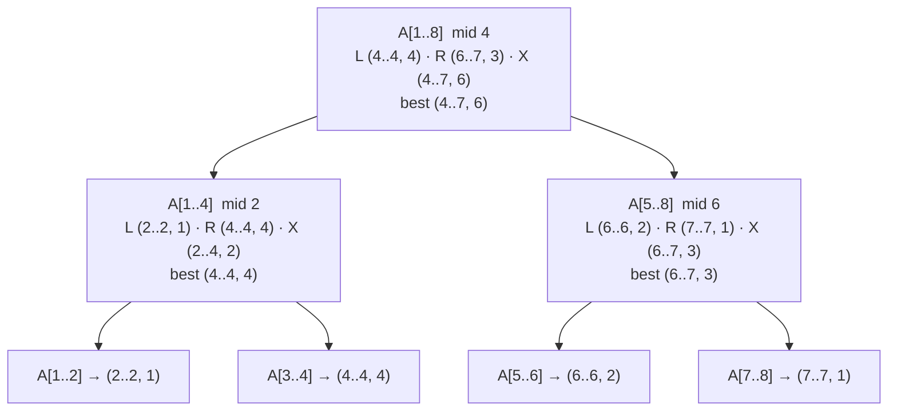

<Callout type="info" title="In one sentence">

Given numbers that can be negative, find the **contiguous** stretch `A[i..j]` with the **largest sum**. Brute
force checks all $\Theta(n^2)$ stretches. Divide & conquer splits at the middle and takes the best of three
answers: best entirely on the **left**, best entirely on the **right**, and best **crossing** the middle
(found in linear time). That gives $T(n) = 2T(n/2) + \Theta(n) = \Theta(n\log n)$.

</Callout>

## Everyday analogy

**Buy low, sell high.** You know a stock's price for each day and may buy once and sell once later. Write
down the **daily change** (today's price minus yesterday's). The profit from buying at the end of day $i-1$ and
selling at the end of day $j$ is the sum of the changes on days $i..j$. So the best trade is the maximum subarray
of the change list. (Buying at the lowest price is not enough on its own: the lowest day might come after every high.)

## Key ideas

**Problem.** Input: `A[1..n]` of positive and negative numbers. Output: indices $i \le j$ with the
greatest sum $A[i] + \dots + A[j]$ over all non-empty contiguous subarrays, plus that sum. The **sum** is
unique, but there may be several subarrays that reach it, so say "**a** maximum subarray".

**Algorithm 1: brute force.** Try every pair $(i, j)$: there are $\binom n2 + n = \frac{n(n+1)}{2}$ of them. With
a running sum for each $i$ that is $\Theta(n^2)$ time.

**Algorithm 2: divide & conquer.** Any subarray of `A[low..high]` either lies **entirely left** of the midpoint,
**entirely right** of it, or **crosses** it. The first two are smaller copies of the same problem (recurse). The
third is easy because it must include both $A[mid]$ and $A[mid+1]$:

```text
MaxCrossingSubarray(A, low, mid, high)
1  leftsum ← −∞;  sum ← 0
2  for i ← mid downto low              // grow leftwards from the middle
3      sum ← sum + A[i]
4      if sum > leftsum then leftsum ← sum; maxleft ← i
5  rightsum ← −∞; sum ← 0
6  for j ← mid + 1 to high             // grow rightwards from the middle
7      sum ← sum + A[j]
8      if sum > rightsum then rightsum ← sum; maxright ← j
9  return (maxleft, maxright, leftsum + rightsum)

MaxSubarray(A, low, high)
1  if high = low then return (low, high, A[low])        // base case: one element
2  mid ← ⌊(low + high) / 2⌋                              // divide
3  (ll, lh, ls) ← MaxSubarray(A, low, mid)              // conquer: left
4  (rl, rh, rs) ← MaxSubarray(A, mid + 1, high)         // conquer: right
5  (xl, xh, xs) ← MaxCrossingSubarray(A, low, mid, high)
6  return whichever of the three has the largest sum     // combine
```

| Step | Work | Cost |
|---|---|---|
| Divide | compute `mid` | $\Theta(1)$ |
| Conquer | two halves | $2T(n/2)$ |
| Crossing + combine | one pass over `A[low..high]`, then compare 3 sums | $\Theta(n)$ |

$$
T(n) = 2T(n/2) + \Theta(n) \;\Rightarrow\; \Theta(n\log n) \quad\text{(same recurrence as merge sort; case 2 of the master theorem in Topic 9).}
$$

---

<Tabs groupId="study-mode" persist items={["Visual", "Worked example", "Guided questions", "Explanation & drill"]}>
<Tab value="Visual">

**From prices to changes** (the lecture's 11-day example):

| Day | 0 | 1 | 2 | 3 | 4 | 5 | 6 | 7 | 8 | 9 | 10 | 11 |
|---|---|---|---|---|---|---|---|---|---|---|---|---|
| Price | 100 | 113 | 110 | 85 | 105 | 102 | 86 | 63 | 81 | 101 | 94 | 106 |
| Change $A[\text{day}]$ | | 13 | −3 | −25 | 20 | −3 | −16 | −23 | **18** | **20** | **−7** | **12** |

Maximum subarray: **`A[8..11]`, sum 43**. Buy at the end of day 7 (price 63) and sell at the end of day 11 (price 106), and $106 - 63 = 43$. ✔

---

**Divide & conquer on `[−2, 1, −3, 4, −1, 2, 1, −5]`** (indices 1–8, our own example). Each box shows the best subarray as `(i..j, sum)`.



At the top, neither half alone wins. The **crossing** subarray `A[4..7] = 4 − 1 + 2 + 1 = 6` does.

</Tab>
<Tab value="Worked example">

**The crossing step at the top level of `[−2, 1, −3, 4, −1, 2, 1, −5]`** ($low = 1$, $mid = 4$, $high = 8$).

Grow **left** from $A[4]$, keeping the best running sum:

| $i$ | $A[i]$ | running sum | best so far (`leftsum`, `maxleft`) |
|---|---|---|---|
| 4 | 4 | 4 | **4, 4** |
| 3 | −3 | 1 | 4, 4 |
| 2 | 1 | 2 | 4, 4 |
| 1 | −2 | 0 | 4, 4 |

Grow **right** from $A[5]$:

| $j$ | $A[j]$ | running sum | best so far (`rightsum`, `maxright`) |
|---|---|---|---|
| 5 | −1 | −1 | −1, 5 |
| 6 | 2 | 1 | 1, 6 |
| 7 | 1 | 2 | **2, 7** |
| 8 | −5 | −3 | 2, 7 |

Crossing answer: `A[4..7]`, sum $4 + 2 = 6$.

**Combine:** left half's best is $(4..4, 4)$, right half's best is $(6..7, 3)$, crossing is $(4..7, 6)$. The max is **6**,
so the answer is `A[4..7] = [4, −1, 2, 1]`.

Note that `rightsum` starts at $-\infty$ rather than 0. That forces the crossing subarray to take **at least one**
element from each side; a crossing subarray must contain both $A[mid]$ and $A[mid+1]$.

---

**Brute force on the same array** checks $\frac{8\cdot9}{2} = 36$ pairs $(i, j)$ and finds the same answer, 6. For
$n = 1000$ that would be 500,500 pairs, against about $n\log_2 n \approx 10{,}000$ steps for divide & conquer.

</Tab>
<Tab value="Guided questions">

**Q1.** Why are the three cases (left, right, crossing) enough?

<Accordions>
<Accordion title="✅ Answer">

A subarray `A[i..j]` either ends at or before $mid$ (entirely left), starts after $mid$ (entirely right), or starts at or before $mid$ and ends after it (crosses). There is no fourth option.

</Accordion>
</Accordions>

**Q2.** Why can the crossing case be found in linear time, but "best subarray anywhere" can't be found the same way?

<Accordions>
<Accordion title="💡 Hint">

What do all crossing subarrays have in common?

</Accordion>
<Accordion title="✅ Answer">

Every crossing subarray contains $A[mid]$ and $A[mid+1]$, so it is "best suffix of the left half" + "best prefix of the right half". The two choices are independent, so one sweep each way finds them. A general subarray has no fixed anchor point.

</Accordion>
</Accordions>

**Q3.** If every number is negative, what does the algorithm return?

<Accordions>
<Accordion title="✅ Answer">

The single **largest** (least negative) element. The problem asks for a **non-empty** subarray, and the base case returns single elements, so the answer is never the empty sum 0.

</Accordion>
</Accordions>

**Q4.** Write and solve the recurrence for MaxSubarray.

<Accordions>
<Accordion title="✅ Answer">

$T(1) = \Theta(1)$; $T(n) = 2T(n/2) + \Theta(n)$. Equal levels ([Topic 8](08-recurrences.mdx)) or master case 2 ([Topic 9](09-master-method.mdx)): $\Theta(n\log n)$.

</Accordion>
</Accordions>

</Tab>
<Tab value="Explanation & drill">

**Explanation.** Max subarray is the textbook example of divide & conquer where the *combine* step does real
work. Splitting in half is trivial, and the two recursive calls handle anything that stays on one side. The
only thing that could be missed is a subarray that **straddles** the cut, and that one is pinned to the middle,
so two linear sweeps (left from $mid$, right from $mid+1$) find it. The result is the same shape as merge sort:
two half-size problems plus linear work, $\Theta(n\log n)$. Brute force is simpler to write and to prove correct but is
$\Theta(n^2)$.

**Drill.**

**1.** Find a maximum subarray of `[1, −4, 3, −4]`.

<Accordions>
<Accordion title="✅ Answer">

`A[3..3] = [3]`, sum 3 (the lecture's Example 1).

</Accordion>
</Accordions>

**2.** Prices `10 11 7 10 14 12 18` (days 0–6). Write the change array and find the best trade.

<Accordions>
<Accordion title="✅ Answer">

Changes `1 −4 3 4 −2 6`. Maximum subarray `A[3..6]`, sum $3 + 4 - 2 + 6 = 11$: buy at day 2 (price 7), sell at day 6 (price 18). ✔ (The lecture's Example 2.)

</Accordion>
</Accordions>

**3.** Compute only the crossing subarray for `[2, −1, −2, 3 | 1, −4, 5]` with $mid = 4$.

<Accordions>
<Accordion title="✅ Answer">

Left from $A[4]$: running sums 3, 1, 0, 2, best **3** at $i = 4$. Right from $A[5]$: 1, −3, 2, best **2** at $j = 7$. Crossing `A[4..7]`, sum **5**.

</Accordion>
</Accordions>

**4.** How many subarrays does an array of length $n$ have?

<Accordions>
<Accordion title="✅ Answer">

$\binom n2 + n = \frac{n(n+1)}{2}$: one per pair $i < j$, plus the $n$ single elements. $\Theta(n^2)$.

</Accordion>
</Accordions>

</Tab>
</Tabs>

---

## Common mistakes

- Treating the problem as "buy at the minimum, sell at the maximum". The minimum may come after the maximum.
- Working on prices instead of **changes**.
- Starting `leftsum`/`rightsum` at 0 instead of $-\infty$. That can return an empty side or a wrong answer when everything is negative.
- In the crossing sweep, going left from $low$ instead of **from $mid$ downwards**. The run must stay attached to the middle.
- Forgetting the crossing case and returning only max(left, right).
- Calling D&C max subarray $\Theta(n)$. With this crossing step it is $\Theta(n\log n)$.

## Mastery check

<Callout type="idea" title="Solve without hints, then explain each of the three cases">

Run MaxSubarray on `[3, −5, 4, −1, 2, −6, 5, 1]` (indices 1–8). For the top call give the best left, best right
and best crossing subarray with their sums, and the final answer. Then state the recurrence and its solution.

</Callout>

<Accordions>
<Accordion title="✅ Answers">

Left half `[3, −5, 4, −1]`: best is `A[3..3] = 4`. Right half `[2, −6, 5, 1]`: best is `A[7..8] = 6`.
Crossing at $mid = 4$: left sweep from $A[4]$: $-1, 3, -2, 1$, best 3 at $i = 3$. Right sweep from $A[5]$: $2, -4, 1, 2$, best 2 at $j = 5$ (2 is reached first, and later ties don't replace it). Crossing `A[3..5]`, sum 5.
**Answer: `A[7..8]`, sum 6.** Recurrence $T(n) = 2T(n/2) + \Theta(n) = \Theta(n\log n)$.

</Accordion>
</Accordions>

<MasteryTracker topic="11-maximum-subarray" />

## See it move

- [VisuAlgo: Recursion tree](https://visualgo.net/en/recursion): enter the recurrence $2T(n/2) + n$ to see why the cost is $n\log n$.

## References

- 09 *The Maximum-Subarray Problem*: Slides 1–3 (buy low / sell high, problem statement), 4–9 (stock examples 1–3), 10–12 (brute force), 13–16 (D&C strategy and correctness), 17–18 (MaxSubarray and MaxCrossingSubarray), 19–20 (remarks and complexity), 21 (worked D&C tree).
- CLRS 3e §4.1 (the maximum-subarray problem); CLRS 4e §4.5 (master method for the recurrence).
