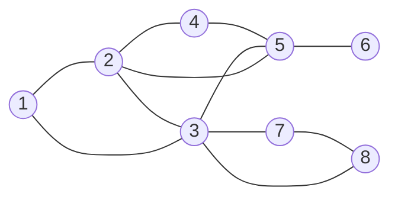
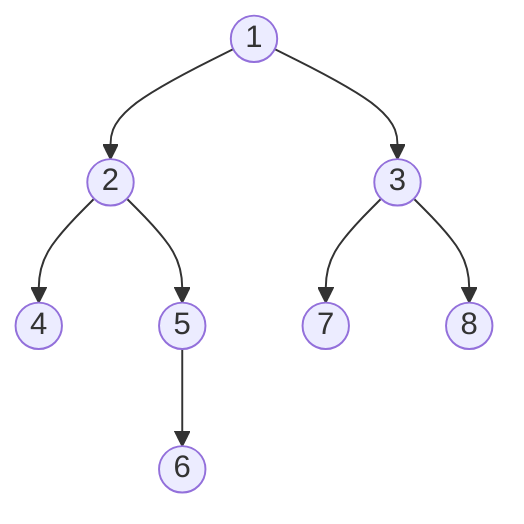

<Callout type="info" title="In one sentence">

A **graph** $G = (V, E)$ is a set of nodes joined by edges ($n = |V|$, $m = |E|$). **Breadth-first search**
explores it outward from a source $s$ **one layer at a time** using a **queue**. It finds every node reachable from $s$
and the **fewest-edges** path to each one, in $\Theta(n + m)$ time with an adjacency list.

</Callout>

## Everyday analogy

**A rumour spreading through a school.** You (the source) tell all your friends on day 1 (layer 1). On day 2
they tell *their* friends who haven't heard it yet (layer 2), and so on. Nobody is told twice. The day someone hears the rumour
is exactly their "friend distance" from you, so BFS layers = shortest distances. The queue is the list of people
who have heard it but haven't passed it on yet.

## Key ideas

**Vocabulary.**

| Term | Meaning |
|---|---|
| adjacent | $u$ and $v$ are joined by an edge; they are the edge's **endpoints** |
| incident | an edge and each of its endpoints are *incident* on each other |
| degree | undirected: number of edges at $v$. Directed: **in-degree** (arrows in) and **out-degree** (arrows out) |
| path / simple path | a sequence of nodes with consecutive pairs joined by edges; *simple* = no repeated node |
| cycle | a path $v_1, \dots, v_k$ with $v_1 = v_k$, $k > 2$, other nodes distinct |
| connected | every pair of nodes has a path between them |
| tree | connected **and** no cycle. Any two of these three (connected, acyclic, $n-1$ edges) imply the third |
| rooted tree | a tree with a chosen root $r$, every edge pointing away from $r$ (parent → child) |

**Handshake fact.** Every edge has two ends, so in an undirected graph $\sum_v \deg(v) = 2m$; in a directed graph
$\sum_v \text{out-deg}(v) = \sum_v \text{in-deg}(v) = m$.

**Two ways to store a graph.**

| | Adjacency **matrix** ($n \times n$ of 0/1) | Adjacency **list** (array of neighbour lists) |
|---|---|---|
| space | $\Theta(n^2)$ | $\Theta(n + m)$ |
| "is $(u,v)$ an edge?" | $\Theta(1)$ | $O(\deg u)$ |
| list all edges / all neighbours | $\Theta(n^2)$ / $\Theta(n)$ per node | $\Theta(n + m)$ / $\Theta(\deg u)$ |
| BFS time | $O(n^2)$ | $O(n + m)$ |

```text
BFS(s)                                   // with path recording
1  for each vertex v: flag[v] ← false; pred[v] ← −1; d[v] ← ∞
2  Q ← empty queue
3  flag[s] ← true; d[s] ← 0; enqueue(Q, s)
4  while Q is not empty
5      v ← dequeue(Q)
6      for each w adjacent to v
7          if flag[w] = false
8              flag[w] ← true             // mark when ENQUEUED, not when dequeued
9              pred[w] ← v; d[w] ← d[v] + 1
10             enqueue(Q, w)
```

**Layers.** $L_0 = \{s\}$; $L_{i+1}$ = nodes not in any earlier layer that have an edge to $L_i$. **Theorem:** $L_i$ is
exactly the set of nodes at distance $i$ from $s$, and $t$ is reachable from $s$ iff it appears in some layer.

**Running time (adjacency list).** Each vertex enters $Q$ once, and processing $v$ costs $\Theta(\deg v)$. So the loop
costs $\sum_v \deg(v) = 2m$ (or $m$ if directed), plus $\Theta(n)$ to set the flags: $\Theta(n + m)$, which is **linear**. With an
adjacency matrix, finding $v$'s neighbours scans a whole row, so it is $\Theta(n^2)$ whatever $m$ is. For a dense graph ($m = \Theta(n^2)$) the two coincide.

---

<Tabs groupId="study-mode" persist items={["Visual", "Worked example", "Guided questions", "Explanation & drill"]}>
<Tab value="Visual">

**The lecture's graph** ($n = 8$, $m = 11$) and its BFS layers from node 1:



| Layer | Nodes | Distance from 1 |
|---|---|---|
| $L_0$ | 1 | 0 |
| $L_1$ | 2, 3 | 1 |
| $L_2$ | 4, 5, 7, 8 | 2 |
| $L_3$ | 6 | 3 |

**The same graph stored two ways:**

| node | adjacency list | degree |
|---|---|---|
| 1 | 2, 3 | 2 |
| 2 | 1, 3, 4, 5 | 4 |
| 3 | 1, 2, 5, 7, 8 | 5 |
| 4 | 2, 5 | 2 |
| 5 | 2, 3, 4, 6 | 4 |
| 6 | 5 | 1 |
| 7 | 3, 8 | 2 |
| 8 | 3, 7 | 2 |

Degrees add up to $22 = 2 \times 11$ (handshake). The matrix would be $8 \times 8 = 64$ cells, with each edge stored twice
($A_{uv} = A_{vu} = 1$).

---

**BFS tree:** keep only the edges `pred[w] → w`. The tree's levels are the BFS layers.



</Tab>
<Tab value="Worked example">

**The lecture's 10-node trace: BFS from source 2.** Adjacency lists (neighbours are scanned in this order):

| v | 0 | 1 | 2 | 3 | 4 | 5 | 6 | 7 | 8 | 9 |
|---|---|---|---|---|---|---|---|---|---|---|
| Adj | 8 | 3, 7, 9, 2 | 8, 1, 4 | 4, 5, 1 | 2, 3 | 3, 6 | 7, 5 | 1, 6 | 2, 0, 9 | 1, 8 |

| Step | Dequeue | Newly marked (pred) | Queue after |
|---|---|---|---|
| start | – | 2 (source) | `2` |
| 1 | 2 | 8, 1, 4 (from 2) | `8 1 4` |
| 2 | 8 | 0, 9 (from 8); 2 already visited | `1 4 0 9` |
| 3 | 1 | 3, 7 (from 1); 9 and 2 already visited | `4 0 9 3 7` |
| 4 | 4 | – | `0 9 3 7` |
| 5 | 0 | – | `9 3 7` |
| 6 | 9 | – | `3 7` |
| 7 | 3 | 5 (from 3) | `7 5` |
| 8 | 7 | 6 (from 7) | `5 6` |
| 9 | 5 | – | `6` |
| 10 | 6 | – | empty: **stop** |

Every node got marked, so every node is reachable from 2. The final **pred** table:

| v | 0 | 1 | 2 | 3 | 4 | 5 | 6 | 7 | 8 | 9 |
|---|---|---|---|---|---|---|---|---|---|---|
| pred | 8 | 2 | – | 1 | 2 | 3 | 7 | 1 | 2 | 8 |
| d | 2 | 1 | 0 | 2 | 1 | 3 | 3 | 2 | 1 | 2 |

**Reporting a path:** follow pred backwards, then reverse. `Path(6)`: 6 ← 7 ← 1 ← 2, so **2 → 1 → 7 → 6** (3 edges, and
no path is shorter). `Path(0)` = 2 → 8 → 0. `Path(1)` = 2 → 1.

---

**Connected components and flood fill.** BFS from $s$ visits exactly $s$'s **connected component**. To find *all*
components, loop over the vertices and start a new BFS from each one that is still unvisited, giving each run a new
label. That is still $\Theta(n + m)$ in total. *Flood fill* in a paint program is the same idea: pixels are nodes,
neighbouring same-colour pixels are edges, and the blob is the component.

</Tab>
<Tab value="Guided questions">

**Q1.** Why does BFS use a queue and not a stack?

<Accordions>
<Accordion title="✅ Answer">

A queue is first-in first-out, so every layer-$i$ node is processed before any layer-$(i+1)$ node. That ordering is what makes the layers equal the distances. A stack would dive deep first (that's DFS, [Topic 13](13-dfs-and-topological-sort.mdx)).

</Accordion>
</Accordions>

**Q2.** In the pseudocode, a node is marked when it is **enqueued**, not when it is dequeued. What would go wrong otherwise?

<Accordions>
<Accordion title="💡 Hint">

In the 10-node trace, node 9 is a neighbour of both 8 and 1.

</Accordion>
<Accordion title="✅ Answer">

The same node could be put on the queue several times (9 would be enqueued by 8 *and* by 1). Answers stay correct but the "each vertex enters $Q$ once" argument breaks, and the queue can grow far beyond $n$.

</Accordion>
</Accordions>

**Q3.** BFS from $s$ in a graph with $n = 1000$ and $m = 3000$, stored as a list vs a matrix. Roughly how much work?

<Accordions>
<Accordion title="✅ Answer">

List: about $n + 2m = 7000$ steps. Matrix: about $n^2 = 1{,}000{,}000$ steps, because every dequeued node scans a full row of 1000 cells. For sparse graphs the list wins hugely.

</Accordion>
</Accordions>

**Q4.** The homework: decide whether an undirected **connected** graph has a cycle, using BFS.

<Accordions>
<Accordion title="💡 Hint">

A tree on $n$ nodes has exactly $n - 1$ edges. How many edges does the BFS tree have?

</Accordion>
<Accordion title="✅ Answer">

Run BFS and build the BFS tree $T$ ($n - 1$ edges). If every edge of $G$ is in $T$ then $G = T$ is a tree: no cycle. If some edge is **not** in $T$ (equivalently $m > n - 1$, or BFS meets an already-visited neighbour that isn't $v$'s pred), that edge closes a cycle: output 1.

</Accordion>
</Accordions>

**Q5.** How would you count the connected components of a graph?

<Accordions>
<Accordion title="✅ Answer">

`count ← 0`; for each vertex $v$: if $v$ is unvisited, `count ← count + 1` and run BFS from $v$ (marking everything it reaches). Total $\Theta(n + m)$, because each vertex and edge is handled by exactly one BFS.

</Accordion>
</Accordions>

</Tab>
<Tab value="Explanation & drill">

**Explanation.** A graph is just *things* (nodes) and *relationships* (edges): cities and flights, web pages and
links, people and friendships. BFS answers "what can I reach from here, and in how few hops?" It keeps a queue of
discovered-but-not-yet-expanded nodes. Taking from the front means it finishes all of distance $i$ before touching distance
$i+1$, so the first time it marks a node is via a shortest path. Recording `pred` along the way lets you print that path
backwards. Each node is queued once and each adjacency list is scanned once, so BFS is linear, $\Theta(n + m)$, *if*
you store the graph as adjacency lists.

**Drill.**

**1.** An undirected graph has degrees 3, 3, 2, 2, 2. How many edges?

<Accordions>
<Accordion title="✅ Answer">

$\sum\deg = 12 = 2m$, so $m = 6$.

</Accordion>
</Accordions>

**2.** Can an undirected graph have degrees 3, 3, 3? Why or why not?

<Accordions>
<Accordion title="✅ Answer">

No: the sum 9 is odd, but $\sum\deg = 2m$ is always even.

</Accordion>
</Accordions>

**3.** In the 10-node trace from source 2, what is $d(5)$ and the path to 5?

<Accordions>
<Accordion title="✅ Answer">

$d(5) = 3$, path 2 → 1 → 3 → 5.

</Accordion>
</Accordions>

**4.** A connected graph has $n = 10$ nodes and $m = 9$ edges. Does it have a cycle?

<Accordions>
<Accordion title="✅ Answer">

No. Connected + $n - 1$ edges ⇒ it is a tree (any two of the three tree properties imply the third).

</Accordion>
</Accordions>

**5.** Space for an adjacency matrix vs list when $n = 10{,}000$ and $m = 20{,}000$?

<Accordions>
<Accordion title="✅ Answer">

Matrix $n^2 = 10^8$ cells. List $\approx n + 2m = 50{,}000$ entries.

</Accordion>
</Accordions>

</Tab>
</Tabs>

---

## Common mistakes

- Marking a node visited when it is **dequeued** instead of when it is **enqueued**, so it gets queued twice.
- Saying BFS is $O(n + m)$ with an adjacency **matrix**. With a matrix it is $\Theta(n^2)$.
- Forgetting to scan neighbours **in the given adjacency-list order** when tracing. The order changes the queue and the BFS tree (but never the distances).
- Using BFS distances on a **weighted** graph. BFS minimises the number of edges, not total weight.
- Building a path forwards from $s$. You only know it backwards: follow `pred` from $v$ to $s$, then reverse.
- Writing $\sum\deg(v) = m$ for an undirected graph. It is $2m$.

## Mastery check

<Callout type="idea" title="Solve without hints, then explain why the queue gives shortest paths">

Using the lecture's 8-node graph (edges 1–2, 1–3, 2–3, 2–4, 2–5, 3–5, 3–7, 3–8, 4–5, 5–6, 7–8, neighbours in increasing
order), run BFS from node 1.

(a) Give the order nodes are dequeued, and every node's distance and pred.

(b) Draw the BFS tree and list the edges of $G$ that are **not** in it. What does their existence tell you?

(c) State the running time with an adjacency list and with a matrix.

</Callout>

<Accordions>
<Accordion title="✅ Answers">

(a) Dequeue order **1, 2, 3, 4, 5, 7, 8, 6**. $d$: 1→0; 2, 3→1; 4, 5, 7, 8→2; 6→3. pred: 2←1, 3←1, 4←2, 5←2, 7←3, 8←3, 6←5.

(b) Tree edges 1–2, 1–3, 2–4, 2–5, 3–7, 3–8, 5–6 (7 = $n - 1$). Non-tree edges: **2–3, 3–5, 4–5, 7–8**. Since $m = 11 > n - 1 = 7$, the graph has cycles (e.g. 1–2–3–1).

(c) $\Theta(n + m)$ with lists; $\Theta(n^2)$ with a matrix.

</Accordion>
</Accordions>

<MasteryTracker topic="12-graphs-and-bfs" />

## See it move

- [VisuAlgo: Graph traversal](https://visualgo.net/en/dfsbfs): pick **BFS**, choose a source, and watch the queue and the layers.
- [VisuAlgo: Graph data structures](https://visualgo.net/en/graphds): the same graph as adjacency matrix, adjacency list and edge list.

## References

- Lecture09 *Graphs: BFS*: Slides 3–11 (definitions, applications, terminology, degree sums, adjacency matrix and list), 12–16 (paths, connectivity, cycles, trees, rooted trees), 18–21 (s-t connectivity, BFS layers and theorem), 22–35 (queue implementation and full trace from source 2), 36 and 59 (cycle-detection homework), 37–38 (running time, list vs matrix), 39–55 (pred array, path reporting, BFS tree), 56–58 (recording distances, CLRS example), 60–65 (connected components, flood fill).
- Kleinberg & Tardos, *Algorithm Design*, Ch. 3 (§3.1 basic definitions, §3.2 graph connectivity and traversal).
- CLRS 4e §20.1 (representations of graphs), §20.2 (breadth-first search). (3rd ed.: §22.1–22.2.)
