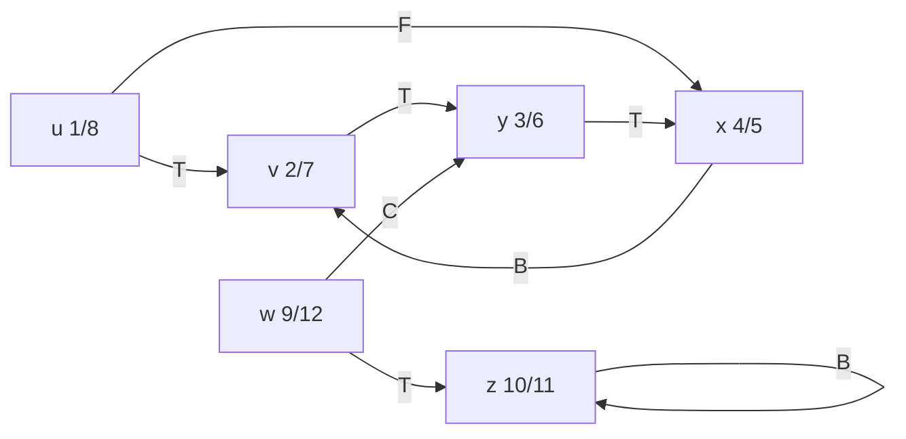
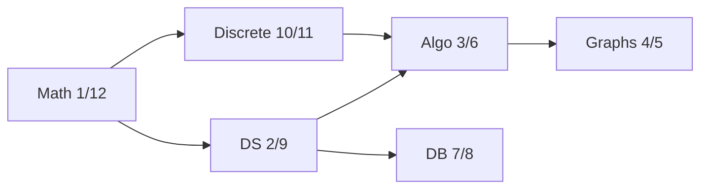

<Callout type="info" title="In one sentence">

**Depth-first search** goes as deep as it can along one path, then **backtracks**, stamping each vertex with a
**discovery time** $d$ and a **finish time** $f$ in $\Theta(n + m)$. Those stamps classify every edge (tree, back,
forward, cross). A graph has a cycle **iff** DFS finds a back edge, and listing the vertices by **decreasing finish time**
gives a **topological sort** of a DAG.

</Callout>

## Everyday analogy

**Exploring a maze with a ball of string.** Walk down one corridor as far as it goes, unrolling string behind you
(the recursion). At a dead end, wind the string back to the last junction with an unexplored corridor and try that. Chalk each
junction the first time you reach it (*discovered*, grey) and again when every corridor from it is done (*finished*,
black). If you ever walk into a junction that is still grey, which means it is on your current string, you've found a loop: a
**back edge**.

## Key ideas

```text
DFS(G)
1  for each vertex u: color[u] ← WHITE; π[u] ← NIL
2  time ← 0
3  for each vertex u
4      if color[u] = WHITE then DFS-Visit(u)        // each call grows one DFS tree

DFS-Visit(u)
1  color[u] ← GRAY;  time ← time + 1;  d[u] ← time  // discovered
2  for each v in Adj[u]
3      if color[v] = WHITE
4          π[v] ← u;  DFS-Visit(v)                  // (u, v) is a tree edge
5  color[u] ← BLACK; time ← time + 1;  f[u] ← time  // finished
```

**Colours:** white = undiscovered, grey = discovered but not finished (on the recursion stack), black = finished.
Always $d[u] < f[u]$, and times run from 1 to $2n$. The parent pointers $\pi$ form a **depth-first forest**
$G_\pi$. Running time: $\Theta(n + m)$ with adjacency lists (each vertex visited once, each list scanned once).

**Edge classification** (for an edge $(u, v)$ when DFS examines it from $u$):

| Type | Meaning | Colour of $v$ when examined |
|---|---|---|
| **Tree (T)** | $v$ discovered through this edge | white |
| **Back (B)** | to an **ancestor** of $u$ (self-loops count) | **grey** |
| **Forward (F)** | non-tree edge to a **descendant** of $u$ | black, and $d[u] < d[v]$ |
| **Cross (C)** | everything else: other branch or other tree | black, and $d[u] > d[v]$ |

In an **undirected** graph only tree and back edges occur.

**Parenthesis theorem.** Write "$(u$" at $d[u]$ and "$u)$" at $f[u]$. The result is always properly nested, so
for any two vertices the intervals $[d, f]$ are either **disjoint** or one **contains** the other (descendant inside ancestor).

**Cycle detection.** $G$ has a cycle $\iff$ DFS finds a back edge.
($\Leftarrow$) A back edge $(u, v)$ plus the tree path $v \leadsto u$ is a cycle. ($\Rightarrow$) Let $v_0$ be the first vertex of the
cycle to be discovered. Everything else on the cycle is still white, so DFS reaches $v_k$ (the vertex just before $v_0$) while $v_0$ is still grey, and
$(v_k, v_0)$ is a back edge.

**Topological sort.** For a **DAG** (directed acyclic graph), e.g. tasks where an arc $(i, j)$ means "$j$ can't start until $i$
finishes", find an order where every arc points forward.

```text
Topological-Sort(G)
1  call DFS(G) to compute finish times f[v]
2  as each vertex finishes, insert it onto the FRONT of a linked list
3  return the list                         // = vertices by decreasing f;  Θ(n + m)
```

Why it works: in a DAG there are no back edges, and for every other edge type $(u, v)$ we get $f[v] < f[u]$. So sorting by
decreasing $f$ puts $u$ before $v$.

---

<Tabs groupId="study-mode" persist items={["Visual", "Worked example", "Guided questions", "Explanation & drill"]}>
<Tab value="Visual">

**The lecture's DFS example** (vertices in order u, v, w, x, y, z; each list in alphabetical order). Labels are
$d/f$; edge letters are the classification.



Two DFS trees: $u \to v \to y \to x$ and $w \to z$.

**Parenthesis structure** of the same run (time goes left to right):

```text
time:  1   2   3   4   5   6   7   8   9   10  11  12
       (u  (v  (y  (x  x)  y)  v)  u)  (w  (z  z)  w)
```

$[4, 5] \subset [3, 6] \subset [2, 7] \subset [1, 8]$ because x is a descendant of y, of v, of u. $[1, 8]$ and $[9, 12]$ are
disjoint because they are in different trees.

---

**Topological sort = read the finish times backwards.** A small course plan:



Decreasing $f$: **Math (12), Discrete (11), DS (9), DB (8), Algo (6), Graphs (5)**. Every arrow points left to right in
that list. ✔

</Tab>
<Tab value="Worked example">

**A. The lecture trace, step by step** (adjacency: u: v, x · v: y · w: y, z · x: v · y: x · z: z).

| time | event | note |
|---|---|---|
| 1 | discover **u** | u is white: start a tree |
| 2 | discover **v** | edge u→v is **T** |
| 3 | discover **y** | v→y is **T** |
| 4 | discover **x** | y→x is **T** |
| – | examine x→v | v is grey (an ancestor): **B** |
| 5 | finish **x** | |
| 6 | finish **y** | |
| 7 | finish **v** | |
| – | examine u→x | x is black and $d[u] = 1 < d[x] = 4$: descendant, **F** |
| 8 | finish **u** | first tree done |
| 9 | discover **w** | next white vertex: new tree |
| – | examine w→y | y is black and $d[w] = 9 > d[y] = 3$: **C** |
| 10 | discover **z** | w→z is **T** |
| – | examine z→z | z is grey (itself): self-loop, **B** |
| 11 | finish **z** | |
| 12 | finish **w** | |

Result: u 1/8, v 2/7, y 3/6, x 4/5, w 9/12, z 10/11. There are back edges, so this graph **has a cycle** (v → y → x → v).

---

**B. Topological sort, the lecture's homework DAG.** Vertices m, n, o, p, q, r, s, t, u, v, w, x, y, z; each adjacency list alphabetical:

| m | n | o | p | q | r | s | u | v | w | y |
|---|---|---|---|---|---|---|---|---|---|---|
| q, r, x | o, q, u | r, s, v | o, s, z | t | u, y | r | t | w, x | z | v |

($t$, $x$, $z$ have no outgoing arcs.) DFS gives these $d/f$ times:

| m | n | o | p | q | r | s | t | u | v | w | x | y | z |
|---|---|---|---|---|---|---|---|---|---|---|---|---|---|
| 1/20 | 21/26 | 22/25 | 27/28 | 2/5 | 6/19 | 23/24 | 3/4 | 7/8 | 10/17 | 11/14 | 15/16 | 9/18 | 12/13 |

Sort by decreasing finish time:

**p, n, o, s, m, r, y, v, x, w, z, u, q, t**

Check a few arcs: o→r (o is 3rd, r is 6th ✔), y→v (7th, 8th ✔), q→t (13th, 14th ✔).

</Tab>
<Tab value="Guided questions">

**Q1.** In DFS, how can you tell a back edge from a forward or cross edge using only colours?

<Accordions>
<Accordion title="✅ Answer">

If $v$ is **grey** when $(u, v)$ is examined, $v$ is still on the recursion stack, so it is an ancestor: back edge. White means tree edge. Black means forward or cross, and you separate those with discovery times ($d[u] < d[v]$ means forward).

</Accordion>
</Accordions>

**Q2.** Why does a back edge mean there's a cycle?

<Accordions>
<Accordion title="✅ Answer">

A back edge $(u, v)$ goes to an ancestor $v$. The tree edges already give a path $v \leadsto u$, and the back edge closes it: $v \leadsto u \to v$.

</Accordion>
</Accordions>

**Q3.** Can a DAG have a topological order if it contains a cycle? What happens if you run Topological-Sort on a graph with a cycle?

<Accordions>
<Accordion title="✅ Answer">

No order exists: on a cycle someone must point backwards. The algorithm still outputs a list, but it is not a valid order. Check for back edges first; a back edge means "not a DAG".

</Accordion>
</Accordions>

**Q4.** Intervals $[2, 9]$ and $[5, 12]$ come from the same DFS. Possible?

<Accordions>
<Accordion title="💡 Hint">

Parenthesis theorem.

</Accordion>
<Accordion title="✅ Answer">

No. They overlap without one containing the other, like "( [ ) ]". DFS intervals are always disjoint or nested.

</Accordion>
</Accordions>

**Q5.** In a course-prerequisite graph, what do in-degree 0 and out-degree 0 mean?

<Accordions>
<Accordion title="✅ Answer">

In-degree 0: a course with no prerequisites (can be taken first). Out-degree 0: a course that nothing depends on. In a topological order, the first vertex always has in-degree 0.

</Accordion>
</Accordions>

</Tab>
<Tab value="Explanation & drill">

**Explanation.** BFS explores level by level with a queue; DFS explores branch by branch with recursion (an implicit
stack). The clock that ticks on every discover and finish is what makes DFS powerful. A vertex is finished only after
everything reachable from it is finished, so in a DAG every arrow $u \to v$ has $f[u] > f[v]$, and reversing the finish order is
a valid schedule. While running, a grey vertex is "on the current path", so meeting a grey vertex means you've walked in
a circle. Both questions, "is there a cycle?" and "what order do I do these tasks in?", fall out of one $\Theta(n + m)$
traversal.

**Drill.**

**1.** DFS on a graph with $n = 6$ vertices: what is the largest finish time?

<Accordions>
<Accordion title="✅ Answer">

$2n = 12$. Every vertex is discovered once and finished once, and each event ticks the clock.

</Accordion>
</Accordions>

**2.** Run DFS (vertices a–e, lists in the order given) on a: b, d · b: c · c: a, d · d: – · e: c, d. Give $d/f$ and classify every edge.

<Accordions>
<Accordion title="✅ Answer">

a 1/8, b 2/7, c 3/6, d 4/5, e 9/10. a→b **T**, b→c **T**, c→a **B**, c→d **T**, a→d **F**, e→c **C**, e→d **C**. The back edge c→a shows the cycle a → b → c → a.

</Accordion>
</Accordions>

**3.** Give a topological order of: shirt → tie, tie → jacket, trousers → shoes, trousers → belt, belt → jacket, socks → shoes.

<Accordions>
<Accordion title="✅ Answer">

One valid order: socks, trousers, shoes, shirt, belt, tie, jacket. Check that every arrow points forward. Many orders are valid; any one that respects all arcs is correct.

</Accordion>
</Accordions>

**4.** Which edge types can appear in DFS of an *undirected* graph?

<Accordions>
<Accordion title="✅ Answer">

Only tree and back edges.

</Accordion>
</Accordions>

</Tab>
</Tabs>

---

## Common mistakes

- Ticking the clock only on discovery. It ticks on **both** discover and finish, so times go up to $2n$.
- Calling an edge to a **black** vertex a back edge. Back edges go to **grey** vertices (ancestors still being explored).
- Mixing up forward and cross: both hit black vertices. Forward goes to a *descendant* ($d[u] < d[v]$), cross does not.
- Sorting by **increasing** finish time, or by discovery time. Topological order is **decreasing** $f$.
- Forgetting the outer loop in `DFS(G)`, so vertices unreachable from the first start are never visited.
- Running topological sort without checking for a cycle. It's only meaningful on a DAG.

## Mastery check

<Callout type="idea" title="Solve without hints, then explain why decreasing finish time works">

Graph (vertices in order Math, DS, Discrete, Algo, Graphs, DB; lists as given): Math: DS, Discrete · DS: Algo, DB ·
Discrete: Algo · Algo: Graphs · Graphs: – · DB: –.

(a) Run DFS and give every vertex's $d/f$.

(b) Classify every edge.

(c) Give the topological order the algorithm produces.

</Callout>

<Accordions>
<Accordion title="✅ Answers">

(a) Math 1/12, DS 2/9, Algo 3/6, Graphs 4/5, DB 7/8, Discrete 10/11.

(b) Math→DS, DS→Algo, Algo→Graphs, DS→DB, Math→Discrete are **T**. Discrete→Algo is **C** (Algo is black and $d = 3 < 10$, not a descendant). No back edges, so it is a DAG.

(c) Decreasing $f$: **Math, Discrete, DS, DB, Algo, Graphs**.

</Accordion>
</Accordions>

<MasteryTracker topic="13-dfs-and-topological-sort" />

## See it move

- [VisuAlgo: Graph traversal](https://visualgo.net/en/dfsbfs): choose **DFS** and watch the grey/black colouring and the edge labels; try **Topological Sort** on a DAG.

## References

- Lecture10 *Graphs: DFS, Topological Sort*: Slides 2–5 (DFS idea, depth-first forest, colours, discovery and finish times), 6 (DFS and DFS-Visit, $\Theta(n + m)$), 7–23 (full trace on u, v, w, x, y, z with edge labels), 24 (classification of edges), 25 (parenthesis structure), 26 (cycle detection), 28–30 (directed graphs for task dependencies, topological sort), 31 (Topological-Sort by finish times), 32 (homework DAG).
- CLRS 4e §20.3 (depth-first search), §20.4 (topological sort). (3rd ed.: §22.3–22.4.)
