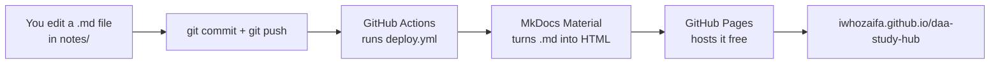

# How this site works

This page explains every tool and file behind the site, so you understand it instead of treating it as
magic.

!!! note "Principle: off-the-shelf, no custom code"
    Everything is a ready-made tool plus configuration. The only `.js` file is `mathjax.js`, copied from the theme's
    official documentation. Exam mode uses the theme's built-in hidden answers and your phone's timer, not a home-made widget.

## The big picture



## Tools (one sentence each, and why each beats building it yourself)

| Tool | What it does | Why not build it yourself |
|---|---|---|
| **Markdown** | Plain-text notes with simple symbols (`#` heading, `**bold**`, tables). | Readable anywhere, diff-able in Git, no lock-in to any app. |
| **Git** | Saves every version of the notes. | You can undo anything and share it later, which a folder of files can't do. |
| **GitHub** | Hosts the Git repository online. | Free, and classmates can suggest fixes (Phase 4). |
| **MkDocs** | Turns a folder of Markdown into a website. | Writing HTML pages by hand for every note would take forever. |
| **Material for MkDocs** | The theme: navigation, search, dark mode, tabs, collapsible answers. | Gives you all of those widgets without writing a line of JavaScript. |
| **pymdown-extensions** | Adds extra Markdown syntax: `=== "Tab"`, `??? "Hidden"`, `$math$`, Mermaid diagrams. | Ready-made and tested, installed together with Material. |
| **MathJax** (loaded from a CDN) | Draws formulas like $T(n) = 2T(n/2) + n$. | Building a maths renderer is a project of its own. |
| **Mermaid** | Draws diagrams from text (flowcharts and trees on topic pages). | Diagrams live inside the note as text, so no image files to keep updated. |
| **GitHub Actions** | A free robot that rebuilds the site every time you push. | No server to run; you never build by hand. |
| **GitHub Pages** | Free web hosting for the built site. | Zero cost, HTTPS included. |
| **uv** | Creates the local Python environment (`.venv/`) and installs MkDocs quickly. | Keeps your system Python clean and avoids version conflicts. |

## Every file, and what it does

| File / folder | Purpose |
|---|---|
| `notes/` | **All the content.** Every `.md` here becomes a page. |
| `notes/index.md` | The home page. |
| `notes/topics/NN-*.md` | One page per topic, each with the 4 study-mode tabs. |
| `notes/study-plan.md`, `notes/progress.md` | The plan and your tracker. |
| `notes/mistakes.md`, `cheatsheet.md`, `which-technique.md` | The toolbox pages, updated after each session. |
| `notes/practice/mock-midterm.md`, `mock-midterm-b.md` | Exam mode: two timed 50-mark papers with hidden answers. |
| `notes/practice/self-study-session.md` | How to run the learning loop on your own (pick mode → explain back → mastery check). |
| `notes/contributing.md`, `CONTRIBUTING.md` | Rules and commands for classmates who want to suggest changes. |
| `notes/javascripts/mathjax.js` | ~10 lines telling MathJax where to find formulas (copied from Material's docs). |
| `mkdocs.yml` | **The site's settings:** name, theme, colours, which extensions are on, and the left-hand navigation (`nav:`). Add a new page? Add it to `nav:` here. |
| `requirements.txt` | Exact versions of MkDocs and friends, so your laptop and GitHub build the same thing. |
| `.github/workflows/deploy.yml` | The GitHub Actions recipe: get the files, install Python, **refuse to continue if a PDF or slide file is tracked** (one `git ls-files \| grep` line), `pip install`, `mkdocs build --strict`, publish. Comments in the file explain each step. |
| `.gitignore` | Files Git must never upload: **all PDFs** (copyrighted slides and book), `.venv/` and `site/` (the build output). |
| `flashcards/daa-flashcards.csv` | Anki flashcards (see below). |
| `README.md` | The front page of the GitHub repository. |

## Everyday commands

Run these from the project folder.

```bash
# Preview the site locally, live-reloading as you edit (open http://127.0.0.1:8000)
.venv/bin/mkdocs serve

# Check for broken links before pushing (same check GitHub runs)
.venv/bin/mkdocs build --strict

# Publish your changes
git add -A
git commit -m "Notes: topic 3 session"
git push            # GitHub Actions rebuilds and deploys in ~1 minute
```

If the Python environment is ever missing: `uv venv .venv && uv pip install --python .venv/bin/python -r requirements.txt`.

## Markdown tricks used on these pages

```markdown
=== "Visual"
    Content of the first tab (indented 4 spaces)

??? success "Answer"
    Hidden until clicked

!!! tip "Title"
    An always-visible box

Inline maths $n\log n$ and display maths $$\sum_{i=1}^n i$$
```

## Flashcards (Anki)

`flashcards/daa-flashcards.csv` holds 70 cards, one per line: `Front,Back,Tags`. Tags look like `t4 insertion`, so you can
study one topic at a time. To import, open Anki → **File → Import** → pick the CSV. The `#…` lines at the top tell
Anki (2.1.55 or newer) the separator and columns, so the defaults are already right. Just choose a deck.
The file also downloads from the repository on GitHub.
Anki then schedules spaced repetition for you, which is why we use it instead of building a quiz app.

## A note on MkDocs 2.0

During the build you'll see a red notice about "MkDocs 2.0". We pin **MkDocs 1.6.1** in
`requirements.txt`, so nothing breaks. You can ignore it for this course.
