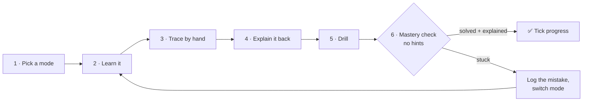

# Self-study session

Use this page to run a study session on a topic **by yourself**, in the same steps a live session with a tutor would follow.
One session takes about 45–60 minutes. Each topic needs one or two of them.

!!! tip "Prefer a live session?"
    In Claude Code, say *"Let's do Topic N"*. The session starts by asking which study mode you want, then
    follows the steps below with you.

## The loop

### 1 · Pick a mode (1 minute)

Ask yourself how you want to learn **right now**, then click that tab on the topic page. The tab you pick
stays selected on every page. Switching modes is fine, and often helps when something isn't clicking.

| If you feel… | Pick |
|---|---|
| "I need to *see* it" | **Visual** |
| "Show me one done properly first" | **Worked example** |
| "Let me figure it out with nudges" | **Guided questions** |
| "Just explain it, then test me" | **Explanation & drill** |

### 2 · Learn it (15 minutes)

Read the analogy and the key rules, then work through your chosen tab. Open hints **only after** two honest minutes of trying.

### 3 · Trace by hand (10 minutes)

On paper, redo the topic's example **with your own numbers**: a new array, a new $n$, a new recurrence. Don't copy the page.
If the topic has a *See it move* link, check your trace against the animation.

### 4 · Explain it back (10 minutes): the most important step

Close the page. Out loud, or written in 5–8 sentences, answer:

1. **One sentence:** what does this idea or algorithm do?
2. **Analogy:** describe it in everyday terms. Your own analogy is better than the page's.
3. **Steps:** walk through your hand trace from step 3 and say *why* each step happens.
4. **Why it's right / how fast:** the invariant, the proof idea, or where the Θ comes from.
5. **Trap:** one mistake a beginner would make here, and how to avoid it.

If you got stuck on a prompt, that part isn't learned yet. Reopen the page on just that part, then try again.

### 5 · Drill (10 minutes)

Do the drill or guided questions **from a tab you didn't use in step 2**, so you see the idea from a second angle.
Mark them with the hidden answers.

### 6 · Mastery check (5–10 minutes)

Do the topic's **Mastery check** with no notes and no hints, then explain your answer using the step 4 prompts.

- **Solved and explained it?** Set the topic to ✅ on [Progress](../progress.md), with the date and the mode that worked.
- **Not quite?** Set it to 🟡, write the mistake in [My mistakes](../mistakes.md) (*what I did → why → fix*), and next
  session try a different mode first.

## After every session (2 minutes)

- Add a row to the session log on [Progress](../progress.md).
- Add anything you had to look up twice to your own copy of the [Cheatsheet](../cheatsheet.md).
- In Anki, study the cards tagged with the topic number (for example `t4`).

## Rules that keep it honest

- **Draft notes are not mastery.** A topic is ✅ only after a no-hint mastery check **and** an explanation in your own words.
- For **assignments**, use the pages for hints and ideas only. Write your own solution.
